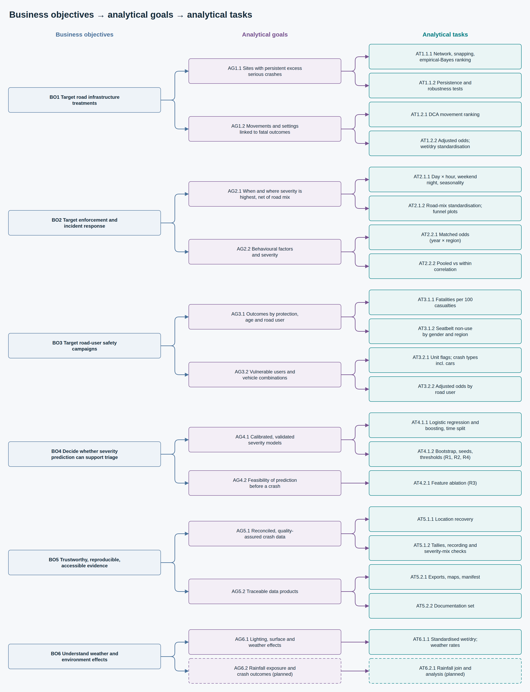

# Analytical goals and tasks — Queensland road crash analysis

*Translates the project's business objectives into analytical goals, and each goal into specific analytical tasks. For every task: the method, the data, where it runs, the result so far, and how it is evaluated. State as of 27 November 2026 (V6). The methods are detailed in [`Analytics_Methods.md`](Analytics_Methods.md) and [`Model_Engineering.md`](Model_Engineering.md).*

> **Status of the business objectives.** Phase 1 of the notebook leaves the operational user and decision open. The objectives below come from the notebook's stated goal ("describe the circumstances and outcomes of recorded Queensland crashes and identify patterns worth testing further") and its *Practical use cases* section. They should be confirmed with stakeholders (Implementation activity A12).

---

## Contents

1. [Structure](#1-structure)
2. [Overview](#2-overview)
3. [Objectives, goals and tasks](#3-objectives-goals-and-tasks)
4. [Traceability matrix](#4-traceability-matrix)
5. [Success criteria](#5-success-criteria)
6. [Scope boundaries](#6-scope-boundaries)

---

## 1. Structure

- **Business objective (BO):** what the organisation wants to achieve, in road-safety terms.
- **Analytical goal (AG):** the objective restated as a question data analytics can answer. Each BO has 1–2 AGs.
- **Analytical task (AT):** a specific, executable piece of analysis that delivers the goal. Each AG has 1–2 ATs.

Goals are labelled by analytics type: **descriptive** (what happened), **diagnostic** (why, or what is associated), **predictive** (what is likely) and **prescriptive support** (where to act).

---

## 2. Overview

*Figure 1. Each business objective links to 1–2 analytical goals, and each goal to 1–2 tasks. Dashed boxes are planned. Editable source: [`Write_Ups/figures/analytical_goals_and_tasks.drawio`](figures/analytical_goals_and_tasks.drawio).*

| Business objective | Analytical goals | Tasks | Status |
|---|---|---|---|
| BO1 Reduce fatal and serious injuries by targeting road infrastructure treatments | AG1.1, AG1.2 | AT1.1.1–AT1.2.2 | Done |
| BO2 Target enforcement and incident-response resources | AG2.1, AG2.2 | AT2.1.1–AT2.2.2 | Done |
| BO3 Target road-user safety campaigns | AG3.1, AG3.2 | AT3.1.1–AT3.2.2 | Done |
| BO4 Decide whether severity prediction can support prioritisation | AG4.1, AG4.2 | AT4.1.1–AT4.2.1 | Done (answer: not yet for operational use) |
| BO5 Provide trustworthy, reproducible and accessible evidence | AG5.1, AG5.2 | AT5.1.1–AT5.2.2 | Done |
| BO6 Understand weather and environment effects | AG6.1, AG6.2 | AT6.1.1–AT6.2.1 | AG6.1 done; AG6.2 planned |

---

## 3. Objectives, goals and tasks

### BO1 — Reduce fatal and serious injuries by targeting road infrastructure treatments

Road authorities need a defensible shortlist of locations and crash types where engineering treatments (barriers, delineation, junction redesign, lighting) are most likely to reduce serious outcomes.

#### AG1.1 Identify road sites with persistent excess serious crashes relative to their setting
*Prescriptive support · CRISP-ML(Q) Phase 3–4*

| Task | Method | Data | Where | Result | Evaluation |
|---|---|---|---|---|---|
| **AT1.1.1** Build a junction and link network, assign crashes to sites, and rank sites by excess serious crashes | Road network from Roads and Tracks; snapping; indirect standardisation by year × site type × speed × remoteness; beta-binomial empirical-Bayes shrinkage | Observed injury crashes 2015–2024; roads layer | `traffic_road_sites.py`; Phase 3 "Screen road sites…" | 5,645 ranked sites. Top: Beechmont Rd (Advancetown), Mt Mee Rd, Mulgrave Rd / Florence St (Cairns). Top links largely motorcycle routes. | Site assignment rate (99.3%); k = 21.4 |
| **AT1.1.2** Test whether the ranking persists and is robust | Two-period test (2015–19 → 2020–24); decile calibration; sensitivity to snapping, minimums and strata | Same | Phase 3 persistence; Phase 4 R6 | Count ranking kept no excess (−3); excess ranking kept +45–50; top-100 overlap 95–100 under variants | E15, E16, R6 |

#### AG1.2 Identify crash movements and road settings most associated with fatal and serious outcomes
*Diagnostic · Phase 2–3*

| Task | Method | Data | Where | Result | Evaluation |
|---|---|---|---|---|---|
| **AT1.2.1** Rank crash movement (DCA) codes by fatal burden and fatal share | Counts, Wilson intervals, share of all fatal crashes | Stable window 2020–2024 | Phase 2 "Detailed movement codes" | Head-on: 3.6% of injury crashes, 19% of fatal; run-off-road codes add 24% | Intervals; minimum counts |
| **AT1.2.2** Estimate adjusted associations of road setting with serious outcomes | Crash-level logistic regression with Wald intervals; direct standardisation for wet/dry × lighting | Stable window | Phase 3 "Adjusted odds"; Phase 2 "Lighting and wet-road comparisons" | 80–90 km/h odds ratio 1.41, remote 1.83, darkness 1.38–1.39, roundabout 0.70; unlit wet ≈ dry ≈ 64% serious | Confidence intervals; comparison with matched odds (E12) |

### BO2 — Target enforcement and incident-response resources

Police and emergency services need to know when, where and with what behaviours severe crashes occur, so patrols, enforcement and response coverage match need.

#### AG2.1 Describe when and where crash severity is highest, after allowing for road mix
*Descriptive and diagnostic · Phase 2*

| Task | Method | Data | Where | Result | Evaluation |
|---|---|---|---|---|---|
| **AT2.1.1** Profile severity by day, hour, time band and month | Day × hour heatmap; weekend-night contrast; seasonal index per day with Wilson intervals | Stable window (shares); complete years (volume) | Phase 2 exploration and "Seasonality by month" | Weekend nights 64.6% serious vs 47.1%; volume lowest January/December, highest August; severity flat by month | Minimum cells; intervals |
| **AT2.1.2** Compare regions and local areas against their road mix | Indirect standardisation; funnel plots with 95%/99.8% limits | Stable window | Phase 2 "Allow for each region's road mix" and "Local areas… funnel plots" | Regions 0.94–1.05 of expected; 5 councils above 99.8% (Moreton Bay, Ipswich, Mackay, Gladstone, Burdekin) | Funnel limits; ratio intervals |

#### AG2.2 Quantify how reported behavioural factors relate to severity
*Diagnostic · Phase 2*

| Task | Method | Data | Where | Result | Evaluation |
|---|---|---|---|---|---|
| **AT2.2.1** Matched odds of a serious outcome for speed, drink driving, fatigue, driver and vehicle flags | Mantel–Haenszel within year × region with Robins–Breslow–Greenland intervals | Grouped files 2020–2024 | Phase 2 "Matched odds…" | Speed 2.79, drink driving 2.57, unlicensed 1.75, fatigue 1.60 | Intervals; pooled vs matched |
| **AT2.2.2** Test whether regional associations hold within region and year | Fixed-effects residual correlation | Region-years 2020–2024 | Phase 2 "Associations that change…" | Speed–severity correlation 0.81 pooled → 0.12 within | E11 |

### BO3 — Target road-user safety campaigns

Safety campaigns need evidence on which road users and protective behaviours are linked to the worst outcomes.

#### AG3.1 Quantify outcomes by protective equipment, age and road user
*Descriptive and diagnostic · Phase 2*

| Task | Method | Data | Where | Result | Evaluation |
|---|---|---|---|---|---|
| **AT3.1.1** Fatalities per 100 casualties by restraint/helmet status, age and road user | Rates with Wilson intervals; "not determined" kept | Restraint and casualty files 2015–2024 | Phase 2 "Fatalities per 100 casualties…" | Unrestrained 9.15 vs restrained 0.85 (10.8×); no helmet 7.58 vs 3.65; pedestrians 75+ 12.1 | Intervals; known-status caveat |
| **AT3.1.2** Seatbelt non-use by gender and region | Pooled flat-file counts; bubble map; Sankey | 2020–2024 | Phase 2 flat-file examples, maps, Sankey | 778 of 31,696 female occupant casualties with known status unrestrained | Flat-file tallies |

#### AG3.2 Quantify severity for vulnerable road users and vehicle combinations
*Descriptive and diagnostic · Phase 2–3*

| Task | Method | Data | Where | Result | Evaluation |
|---|---|---|---|---|---|
| **AT3.2.1** Severity by road user, vehicle and crash type (including cars) | Crash-level unit flags; mutually exclusive crash types; Wilson intervals | Stable window | Phase 2 "Road users and vehicles in each crash" | Pedestrian 4.1% fatal; single car 30% of fatal crashes; car-on-car 0.6% fatal; motorcycle-only 5.2% | Matches grouped table exactly (E8); car-flag check (E9) |
| **AT3.2.2** Adjusted odds by road user and vehicle | Logistic regression adjusted for setting, time, region and year | Stable window | Phase 3 "Adjusted odds" | Motorcycle 3.35, pedestrian 2.97, single vehicle 2.14, bicycle 2.13, truck 1.31, bus 1.01 | Intervals; vs matched odds (E12) |

### BO4 — Decide whether severity prediction can support prioritisation

Before investing in a predictive tool, decision-makers need evidence on whether crash severity can be predicted reliably enough to act on.

#### AG4.1 Build and evaluate calibrated severity models on held-out years
*Predictive · Phase 3–4*

| Task | Method | Data | Where | Result | Evaluation |
|---|---|---|---|---|---|
| **AT4.1.1** Train logistic regression and gradient boosting for serious and fatal outcomes | Time split 2020–22 / 2023 / 2024; validation-year threshold | Injury crashes, 16 categorical fields + hour + unit counts | Phase 3 "Train the severity models" | Fatal average precision 0.13 vs V5's 0.091 (V5 test years); serious ROC AUC 0.72 | ROC AUC, average precision, Brier skill, reliability |
| **AT4.1.2** Test reliability of the results | Paired bootstrap, seed stability, threshold sensitivity | Test year 2024 | Phase 4 "Reliability and sensitivity experiments" (R1, R2, R4) | Models equivalent; fatal average precision 0.09–0.15; stable across seeds; no good operating point | Bootstrap intervals; overlap of differences with 0 |

#### AG4.2 Determine whether prediction is feasible from information available before a crash
*Predictive feasibility · Phase 4*

| Task | Method | Data | Where | Result | Evaluation |
|---|---|---|---|---|---|
| **AT4.2.1** Feature ablation to road, time and environment inputs only | Refit gradient boosting without crash description and unit counts | Same | Phase 4 R3 | Fatal average precision 0.051 (2.7× random), ROC AUC 0.74: only weakly feasible | Average precision against random baseline |

### BO5 — Provide trustworthy, reproducible and accessible evidence

Findings are only useful if users can trust them and reach them.

#### AG5.1 Produce a reconciled, quality-assured crash dataset
*Data quality · Phase 2*

| Task | Method | Data | Where | Result | Evaluation |
|---|---|---|---|---|---|
| **AT5.1.1** Recover missing locations and reconcile labels | Donor medians, public road and address layers, polygon lookups | Crash file; spatial layers | `traffic_location_recovery.py`; Phase 2 | 127 of 598 coordinate pairs recovered; 28 suburbs | Holdout errors (E3–E5); byte-identical to V5 |
| **AT5.1.2** Verify consistency and detect recording changes | Cross-file tallies; recording-change and severity-mix checks | All six files | Phase 2 | All tallies agree; four recording changes; stable window 2020–2024 | Assertions; R5 |

#### AG5.2 Deliver results in accessible and traceable products
*Deployment · Phase 5–6*

| Task | Method | Data | Where | Result | Evaluation |
|---|---|---|---|---|---|
| **AT5.2.1** Export analysis tables, maps and manifest | Tableau-ready tables; Folium/Esri page; SHA-256 manifest | All outputs | Phase 5 | 35 tables, 4 map views, manifest; V6 workbook (12 dashboards) as `.twbx` and linked `.twb`. | Export assertions; checksums |
| **AT5.2.2** Document data, methods, models and design | Markdown documentation set | — | Repository root | 8 documents | Brief coverage maps in each document |

### BO6 — Understand weather and environment effects

Weather and lighting programmes (wet-weather surfacing, lighting upgrades, warning systems) need evidence on how conditions affect outcomes.

#### AG6.1 Quantify how lighting, surface and recorded weather relate to severity
*Diagnostic · Phase 2*

| Task | Method | Data | Where | Result | Evaluation |
|---|---|---|---|---|---|
| **AT6.1.1** Standardised wet/dry by lighting; fatalities per 100 crashes by weather | Direct standardisation; exact Poisson intervals | 2020–2024 | Phase 2 | Unlit wet ≈ dry ≈ 64% serious; fog 2.6–7.3 per 100 vs clear 2.0–2.2 | Intervals; minimum strata |

#### AG6.2 Relate external rainfall to crash frequency and severity
*Diagnostic · planned*

| Task | Method | Data | Where | Result | Evaluation |
|---|---|---|---|---|---|
| **AT6.2.1** Join rainfall at each crash location by month or candidate days; compare counts and severity with the rainfall anomaly | SILO or BoM rainfall; join design in `Implementation_Design.md` §16 | Rainfall amounts (to collect); BoM station list (held) | Planned `traffic_weather.py` | — | Agreement with recorded "Raining"; sensitivity to the match method |

---

## 4. Traceability matrix

| BO | AG | AT | Methods doc | Notebook phase | Main exports | Experiments |
|---|---|---|---|---|---|---|
| BO1 | AG1.1 | AT1.1.1–2 | Model_Engineering §5 | 3–4 | `result_hotspots`, `result_site_screening`, `result_site_persistence`, `result_site_sensitivity` | E14–E18, R6 |
| BO1 | AG1.2 | AT1.2.1–2 | Analytics_Methods §2.5; Model_Engineering §4 | 2–3 | `result_dca_codes`, `result_adjusted_odds`, `result_wet_dry_standardised` | E12 |
| BO2 | AG2.1 | AT2.1.1–2 | Analytics_Methods §2.3–2.4 | 2 | `result_month_*`, `result_region_road_mix`, `result_area_funnel` | E10, E23 |
| BO2 | AG2.2 | AT2.2.1–2 | Analytics_Methods §2.8 | 2 | `result_matched_odds`, `result_speed_severity_region_year` | E11 |
| BO3 | AG3.1 | AT3.1.1–2 | Analytics_Methods §2.7 | 2 | `result_equipment_fatality_rates`, context flat file | — |
| BO3 | AG3.2 | AT3.2.1–2 | Analytics_Methods §2.6; Model_Engineering §4 | 2–3 | `result_unit_involvement`, `result_crash_composition`, `result_adjusted_odds` | E8, E9, E12 |
| BO4 | AG4.1 | AT4.1.1–2 | Model_Engineering §3, §11 | 3–4 | `result_model_*` | E19, E20, R1, R2, R4 |
| BO4 | AG4.2 | AT4.2.1 | Model_Engineering §11 | 4 | `result_model_feature_ablation` | R3 |
| BO5 | AG5.1 | AT5.1.1–2 | Data_Engineering §3–6 | 2 | Cleaned and reconciliation CSVs, `result_severity_mix_by_year`, `result_window_tolerance` | E1–E7, R5 |
| BO5 | AG5.2 | AT5.2.1–2 | Implementation_Design §10, §18 | 5–6 | `Tableau data V6/`, Esri page, manifest | — |
| BO6 | AG6.1 | AT6.1.1 | Analytics_Methods §2.5, §2.7 | 2 | `result_wet_dry_standardised`, context flat file | — |
| BO6 | AG6.2 | AT6.2.1 | Implementation_Design §16 | planned | planned | E22, E24 |

---

## 5. Success criteria

| Goal | Criterion | Met? |
|---|---|---|
| AG1.1 | Site ranking keeps a positive excess in a later period, and is robust to analyst choices (≥90 of the top 100 kept) | Yes: +45–50 later excess; 95–100 overlap |
| AG1.2 | Each reported association has a confidence interval and adjusts for road setting | Yes |
| AG2.1 | Area differences are shown against road mix with chance limits | Yes (funnel plots) |
| AG2.2 | Behavioural associations are shown within year × region | Yes (matched odds); crash-level adjustment not possible for these flags |
| AG3.1 | Rates per casualty with intervals; unknown status kept visible | Yes |
| AG3.2 | Every road-user group, including cars, covered at crash level | Yes |
| AG4.1 | Models beat V5 and a baseline on held-out years, with calibrated probabilities and reported uncertainty | Yes. Operational acceptance criteria not yet agreed. |
| AG4.2 | Clear answer on prediction before a crash | Yes: weak (0.051 average precision) |
| AG5.1 | Zero unexplained tally differences; recording changes documented; V5 outputs reproduced | Yes |
| AG5.2 | Every number traceable to a run; products accessible to non-programmers | Yes |
| AG6.1 | Weather and lighting comparisons standardised and with intervals | Yes |
| AG6.2 | Rainfall joined and analysed | Not yet (data to collect) |

---

## 6. Scope boundaries

- **In scope:** recorded Queensland crashes and casualties, 2001–2025; outcomes among recorded crashes; public spatial reference layers.
- **Out of scope for now:**
  - Risk per trip, kilometre or person (no exposure data).
  - Causal effects of treatments (no before/after treatment records).
  - Predicting where or when crashes will occur (the models describe severity given a crash).
  - Analysis needing the crash date or identities.

---

<!-- project-docs-nav -->
**Project documentation:** [Index](Documentation_Index.md) · **Goals and tasks** · [Data and resources](Data_and_Resources.md) · [Data engineering](Data_Engineering.md) · [Analytics methods](Analytics_Methods.md) · [Model engineering](Model_Engineering.md) · [Implementation design](Implementation_Design.md) · [System architecture](Analytical_System_Architecture.md) · [Timeline and milestones](Timeline_and_Milestones.md) · [Risk management](Risk_Management.md)
