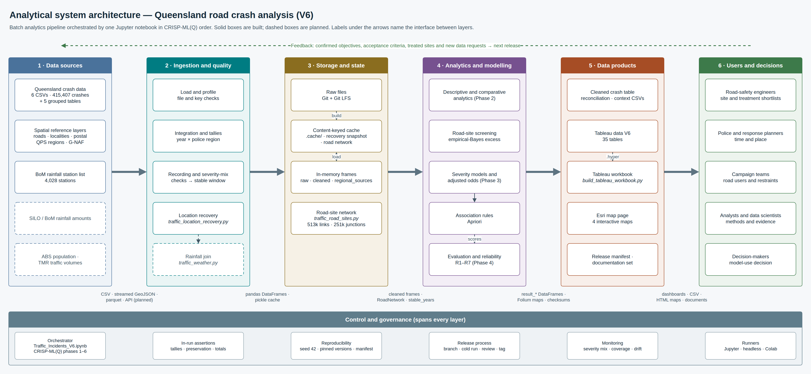
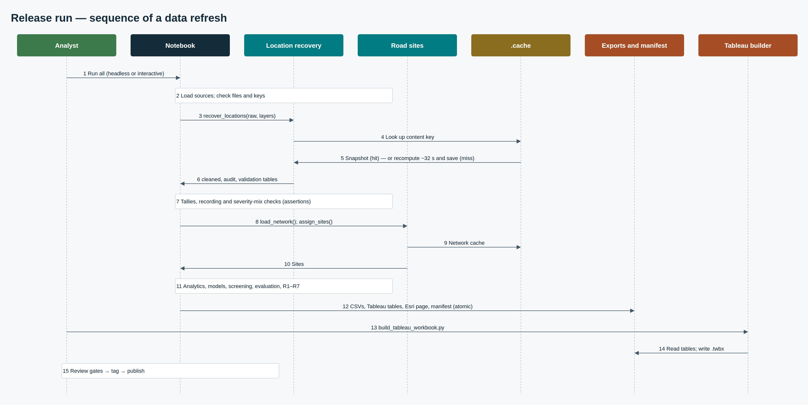

# Analytical system architecture — Queensland road crash analysis

*Describes the analytical system behind V6 (27 November 2026): its layers and components, how they connect and communicate, how the system operates in each run mode, and how users interact with it. The figure below is the main view; the sections that follow explain it. Implementation detail is in [`Implementation_Design.md`](Implementation_Design.md); the goals the system serves are in [`Analytical_Goals_and_Tasks.md`](Analytical_Goals_and_Tasks.md).*

---

## Contents

1. [Architecture figure](#1-architecture-figure)
2. [Architectural style](#2-architectural-style)
3. [Layers and functionality](#3-layers-and-functionality)
4. [Interconnections and communication](#4-interconnections-and-communication)
5. [Operations: how a run works](#5-operations-how-a-run-works)
6. [Interactions with users](#6-interactions-with-users)
7. [How the architecture serves the analytical goals](#7-how-the-architecture-serves-the-analytical-goals)
8. [Quality attributes](#8-quality-attributes)
9. [Target architecture (planned extensions)](#9-target-architecture-planned-extensions)

---

## 1. Architecture figure



*Figure 1. Six layers, from data sources on the left to users on the right, with a control and governance band across all of them. Solid boxes are built; dashed boxes are planned. Labels under the arrows name the interface between layers. The dashed green arrow is the feedback loop from users into the next release. Editable draw.io source: [`Write_Ups/figures/analytical_system_architecture.drawio`](figures/analytical_system_architecture.drawio).*

All diagrams are draw.io files in `Write_Ups/figures/`, generated by `Write_Ups/figures/make_drawio_diagrams.py` and exported to PNG with the draw.io desktop CLI (`make_drawio_diagrams.py --png`). Open the `.drawio` files in draw.io desktop, app.diagrams.net or the VS Code *Draw.io Integration* extension to edit them.

| Diagram | Editable source | Image | Used in |
|---|---|---|---|
| Analytical system architecture | `analytical_system_architecture.drawio` | `analytical_system_architecture.png` | This document §1 |
| Release-run sequence | `release_run_sequence.drawio` | `release_run_sequence.png` | This document §5.1 |
| Implementation components and data flow | `implementation_components.drawio` | `implementation_components.png` | `Implementation_Design.md` §2 |
| Business objectives → goals → tasks | `analytical_goals_and_tasks.drawio` | `analytical_goals_and_tasks.png` | `Analytical_Goals_and_Tasks.md` §2 |

---

## 2. Architectural style

| Characteristic | Choice | Reason |
|---|---|---|
| Processing model | **Batch pipeline**, run at each data release | Crash data arrives in periodic releases, and no decision needs instant predictions (cheat sheet: batch deployment) |
| Orchestration | **One notebook as orchestrator**, calling Python modules for heavy steps | Analysts can read the logic and the results together. Modules keep slow geospatial code testable and reusable. |
| Coupling | **File-based** between runs (CSV, GeoJSON, parquet, pickle, JSON); **in-memory DataFrames** within a run | Simple and transparent. Any output can be opened without the code. |
| State | Stateless run with a **content-keyed cache** | Same inputs and code give the same outputs. The cache only speeds things up and never changes results. |
| Layering | Sources → ingestion and quality → storage and state → analytics → products → users, with **governance across all layers** | Each layer has one job, and the quality checks sit before any analysis |
| Process model | CRISP-ML(Q) phases map onto the layers (§3) | Quality assurance at every phase |

---

## 3. Layers and functionality

| Layer | Components | Functionality | CRISP-ML(Q) phase |
|---|---|---|---|
| **1 · Data sources** | Six crash CSVs; five spatial layers; BoM station list. *Planned:* rainfall amounts, ABS population, traffic volumes. | Supply raw facts (`Data_and_Resources.md`) | 1 |
| **2 · Ingestion and quality** | Load and profile; integration and tallies; recording and severity-mix checks; `traffic_location_recovery.py`. *Planned:* `traffic_weather.py`. | Read and validate inputs; align keys; detect recording changes; derive the stable window; recover missing locations | 1–2 |
| **3 · Storage and state** | Raw files in Git LFS; `.cache/` pickles; in-memory frames (`raw`, `cleaned`, `regional_sources`); `traffic_road_sites.py` network | Hold sources immutably; cache slow results; carry prepared data through the run; provide the road network | 2–3 |
| **4 · Analytics and modelling** | Descriptive and comparative analytics; road-site screening; severity models and adjusted odds; association rules; evaluation and reliability (R1–R7) | Answer the analytical goals; test their reliability | 2–4 |
| **5 · Data products** | Cleaned, reconciliation and context CSVs; `Tableau data V6/` (35 tables); Tableau workbook (`build_tableau_workbook.py`); Esri map page; release manifest and documents | Package results for each audience with full traceability | 5 |
| **6 · Users and decisions** | Engineers, police planners, campaign teams, analysts, decision-makers | Use the results; feed back objectives, acceptance criteria and new data needs | 6 and Phase 1 of the next cycle |
| **Governance (band)** | Notebook orchestrator; in-run assertions; seed and pinned versions; release process; monitoring; runners | Make every run correct, reproducible, reviewable and monitored | All |

---

## 4. Interconnections and communication

### 4.1 Interfaces between components

| # | From → To | Mechanism | Format | Notes |
|---|---|---|---|---|
| 1 | Crash CSVs → loader | File read (`pandas.read_csv`) | CSV | Existence checked first; unique crash reference asserted |
| 2 | Spatial layers → recovery and site modules | Streamed read (`ijson`, `pyshp`, `pyarrow`) | GeoJSON.gz, zipped shapefile, parquet | Streaming keeps memory low |
| 3 | Recovery module ⇄ cache | `pickle` load and atomic save | `.pkl` keyed by SHA-256 of data and code | Cache hit in about 3 s, miss about 32 s |
| 4 | Site module ⇄ cache | Same | `.pkl` keyed by roads file and module digest | About 10 s rebuild |
| 5 | Modules → notebook | Python function calls | `LocationRecovery` dataclass, `RoadNetwork`, DataFrames | Documented signatures (`Implementation_Design.md` §6) |
| 6 | Notebook cells → notebook cells | Shared kernel variables | DataFrames, Index objects, fitted models | Cells run top to bottom |
| 7 | Analytics → exports | Atomic file write | CSV (UTF-8), HTML, JSON | Assertions on totals before writing |
| 8 | Exports → Tableau builder | File read | CSV → `.hyper` extracts → `.twbx` (packaged) and `.twb` (linked to `Tableau data V6/`) | Builder checks every field reference before writing |
| 9 | Products → users | Tableau Public/Server, browser, shared folder, Git | Dashboards, HTML, CSV, Markdown | Release notes link everything |
| 10 | Users → next release | Review meetings, issues, data requests | Signed-off objectives, treated-site lists, new sources | The feedback loop in Figure 1 |
| 11 (planned) | Rainfall service → weather module | HTTPS API (SILO) or file download (BoM) | CSV or JSON | Credential supplied at run time; cached locally |

### 4.2 Data lineage

Every output can be traced back to its inputs:

```text
input file (SHA-256 in manifest)
  → module / notebook section (named in each document)
    → DataFrame (named variable)
      → export file (SHA-256 in manifest)
        → Tableau sheet or map view
```

The lineage records are:
- the release manifest (inputs, code, exports, constants);
- the cache keys (which data and code produced a cache);
- the "What this achieved" notes (results of that exact run).

---

## 5. Operations: how a run works

### 5.1 Release run sequence



*Figure 2. Messages between the analyst, the notebook, the two modules, the cache, the exports and the Tableau builder during a release run. Editable source: [`Write_Ups/figures/release_run_sequence.drawio`](figures/release_run_sequence.drawio).*

### 5.2 Run modes

| Mode | Trigger | What runs | Time |
|---|---|---|---|
| Interactive analysis | Analyst in VS Code or Jupyter | Any cells, usually all | About 1 minute warm |
| Headless release run | Data refresh (§18 of `Implementation_Design.md`) | Whole notebook from a clean cache | About 1.5 minutes |
| Colab | No local environment | Whole notebook from Google Drive | Depends on Colab |
| Module CLI | Spatial check only | `python traffic_spatial_lookup.py` | Minutes |
| Workbook build | After a release run | `build_tableau_workbook.py` | Seconds to minutes |

### 5.3 Failure handling

- **Fail fast:** a missing file or a failed assertion stops the run before any export is written.
- **Atomic writes:** an export or cache is either complete or absent, never half-written.
- **Self-healing cache:** a changed input or module gives a new cache key, so stale results can't be reused.
- **Rollback:** the previous tagged release's files are immutable and checksummed, and can be re-published.

---

## 6. Interactions with users

| User | Touchpoint | What they get | What they send back |
|---|---|---|---|
| Road-safety engineers | Site map (Esri page), `result_hotspots`, Tableau | Ranked junctions and links with expected vs recorded serious crashes, motorcycle share and stacked points | Treated sites, site-visit findings |
| Police and response planners | Tableau time and place dashboards, funnel tables | Severity by time, region and area, net of road mix | Operational priorities |
| Campaign teams | Restraint and road-user results, Sankeys, maps | Rates by protection, age, road user; crash types including cars | Campaign periods for evaluation |
| Analysts and data scientists | Notebook, modules, methods documents, `result_*` tables | Full method, code and experiment evidence | Method changes through branches |
| Decision-makers | Release notes, `Analytical_Goals_and_Tasks.md`, model evaluation | Goal-by-goal status; model feasibility answer | Confirmed objectives, acceptance criteria, model-use decision |

---

## 7. How the architecture serves the analytical goals

| Goal | Layers involved | Path through the system |
|---|---|---|
| AG1.1 Sites with excess serious crashes | 1 → 2 → 3 (network, cache) → 4 (screening, R6) → 5 (map, tables) → engineers | Roads layer and observed crashes → network and snapping → empirical-Bayes ranking → site map |
| AG1.2, AG3.2 Movements, settings, road users | 1 → 2 → 3 → 4 (descriptive, adjusted odds) → 5 | Cleaned crashes → DCA, crash types, logistic regression → tables and charts |
| AG2.1, AG2.2 Time, place, behaviour | 1 → 2 → 3 → 4 (descriptive, standardisation, matched odds) → 5 | Crash and grouped files → heatmaps, funnels, matched odds → dashboards |
| AG3.1 Protection and casualties | 1 → 2 (tallies) → 3 → 4 → 5 | Restraint and casualty files → rates with intervals → context file and maps |
| AG4.1, AG4.2 Prediction feasibility | 2 (stable window) → 3 → 4 (models, R1–R4) → 5 | Window → time-split models → reliability experiments → model tables |
| AG5.1, AG5.2 Trustworthy products | 2 (checks, recovery) → governance → 5 | Assertions and manifest throughout |
| AG6.2 Rainfall (planned) | 1 (rainfall) → 2 (weather module) → 3 → 4 → 5 | Dashed path in Figure 1 |

---

## 8. Quality attributes

| Attribute | How the architecture provides it |
|---|---|
| **Correctness** | Quality layer before analytics; assertions at every hand-off; V5 regression check after refactoring |
| **Reproducibility** | Immutable sources, seed, pinned versions, content-keyed caches, manifest checksums |
| **Traceability** | Lineage chain (§4.2); every note written from the run's outputs |
| **Performance** | Streaming reads, vectorised geometry, cached heavy steps. Full run in about 1 minute. |
| **Maintainability** | Layered design; modules with documented interfaces; one place per concern; design documents kept with the code |
| **Extensibility** | A new source plugs into layer 2 as a module with its own cache (the rainfall design follows this pattern) |
| **Security and privacy** | Public, de-identified data only; no date reconstruction or linkage; no stored credentials; caches only from local runs |
| **Usability** | Products matched to audiences: dashboards and maps for users, CSVs for analysts, notebook and documents for reviewers |

---

## 9. Target architecture (planned extensions)

| Addition | Layer | Change |
|---|---|---|
| Rainfall amounts and `traffic_weather.py` | 1, 2 | New source and module with cache; rainfall columns join the cleaned frame |
| ABS population and traffic volumes | 1, 2, 4 | Rates per person or vehicle; safety performance function in site screening |
| Lockfile, Docker image, pytest suite | Governance | Reproducible runtime and module tests before the release run |
| Scheduler (cron or Prefect) | Governance | Automated release run when new crash data is detected |
| V6 Tableau workbook | 5 | Builder updated for the V6 tables |
| Model registry (MLflow) | 3–5 | Only if a model is put into operation, with shadow deployment |

---

<!-- project-docs-nav -->
**Project documentation:** [Index](Documentation_Index.md) · [Goals and tasks](Analytical_Goals_and_Tasks.md) · [Data and resources](Data_and_Resources.md) · [Data engineering](Data_Engineering.md) · [Analytics methods](Analytics_Methods.md) · [Model engineering](Model_Engineering.md) · [Implementation design](Implementation_Design.md) · **System architecture** · [Timeline and milestones](Timeline_and_Milestones.md) · [Risk management](Risk_Management.md)
