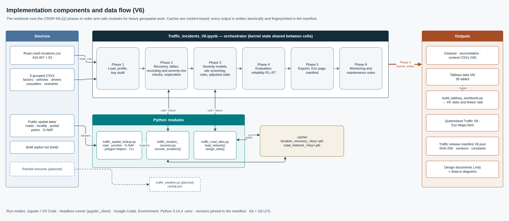

# Implementation design — Queensland road crash analysis

*Describes how the V6 analysis is built (27 November 2026): components, data flow, notebook structure, module interfaces, caching, configuration, validation, outputs, run procedure, conventions, technical debt and the planned rainfall extension. The companion documents cover the data work ([`Data_Engineering.md`](Data_Engineering.md)), the models ([`Model_Engineering.md`](Model_Engineering.md)) and the analyses and experiments ([`Analytics_Methods.md`](Analytics_Methods.md)).*

---

## Contents

1. [Design goals](#1-design-goals)
2. [Architecture overview](#2-architecture-overview)
3. [Components](#3-components)
4. [Data flow](#4-data-flow)
5. [Notebook design](#5-notebook-design)
6. [Module interfaces](#6-module-interfaces)
7. [Caching](#7-caching)
8. [Configuration and constants](#8-configuration-and-constants)
9. [Validation and testing strategy](#9-validation-and-testing-strategy)
10. [Outputs and contracts](#10-outputs-and-contracts)
11. [Running the analysis](#11-running-the-analysis)
12. [Environment and dependencies](#12-environment-and-dependencies)
13. [Conventions](#13-conventions)
14. [Security, privacy and licensing](#14-security-privacy-and-licensing)
15. [Technical debt and known issues](#15-technical-debt-and-known-issues)
16. [Planned extension: rainfall](#16-planned-extension-rainfall)
17. [Development environment, tools and frameworks](#17-development-environment-tools-and-frameworks)
18. [Deployment plan](#18-deployment-plan)
19. [Maintenance plan](#19-maintenance-plan)
20. [Implementation activities and milestones](#20-implementation-activities-and-milestones)
21. [Risk register](#21-risk-register)

> **Coverage of the implementation brief.** Detailed design of how the tasks are implemented: §2–§11, with tasks mapped in §20 and in [`Analytical_Goals_and_Tasks.md`](Analytical_Goals_and_Tasks.md). Development environment, libraries, tools and frameworks: §12 and §17. Deployment plan: §18. Maintenance plan: §19. Implementation activities: §20, with risks in §21. System architecture figure: [`Analytical_System_Architecture.md`](Analytical_System_Architecture.md).

---

## 1. Design goals

| Goal | How it is met |
|---|---|
| **Traceable** | Every number in the notes is computed in the same run. The results-at-a-glance cell reads variables, not typed values. The release manifest fingerprints inputs, code and exports. |
| **Reproducible** | Fixed seed, pinned package versions, deterministic caches keyed on content, and a top-to-bottom run with no manual steps |
| **Readable by analysts** | One notebook in CRISP-ML(Q) order. Every code cell is preceded by **In this cell** and followed by **What this achieved**, with the run's results. |
| **Safe for source data** | Sources are read-only. Estimates never overwrite recorded values. Exports are written all or nothing (atomic). |
| **Fast to iterate** | Slow geospatial work moved to modules with content-keyed caches. A full warm run takes about a minute. |
| **Lightweight** | Runs locally on a laptop-class machine with no database or cluster. New dependencies are added only when they earn their place. |

---

## 2. Architecture overview



*Figure 1. Components and data flow. Editable source: [`Write_Ups/figures/implementation_components.drawio`](figures/implementation_components.drawio). The layered system view is in [`Analytical_System_Architecture.md`](Analytical_System_Architecture.md).*

The notebook is the orchestrator and holds all analysis logic. The modules hold geospatial plumbing that is slow, long, or reused outside the notebook. The Tableau builder is a separate post-processing step that reads the notebook's exports and writes the V6 workbook.

---

## 3. Components

| Component | Type | Responsibility | Size |
|---|---|---|---|
| `Traffic_Incidents_V6.ipynb` | Notebook | Loads sources, audits, prepares and explores data, models, evaluates, exports, writes the manifest | 177 cells (41 code) |
| `traffic_location_recovery.py` | Python module | Coordinate and locality recovery pipeline (V5 cells 16–41), with cache | 752 lines |
| `traffic_spatial_lookup.py` | Python module and CLI | Public-layer helpers: name normalisation, junction and corridor tests, G-NAF, polygon lookups. Standalone CLI `main(layers)`. | 579 lines |
| `traffic_road_sites.py` | Python module | Junction and link network from the roads layer; crash-to-site assignment; labels and geometry | 249 lines |
| `build_tableau_workbook.py` | Script | Generates `.twb`/`.twbx` from in-code sheet and dashboard specs; writes `.hyper` extracts (`tableauhyperapi`); checks field references | 801 lines |
| `.cache/build_v6/build_v6.py` | Scratch tool | Assembled V6 from V5 cells plus `cells/*.py|md`. Not part of the run. | — |
| `.cache/build_v6/run_notebook.py` | Scratch tool | Headless executor built on `jupyter_client`, used because `nbconvert` is not installed | — |
| `Traffic Data.code-workspace`, `.vscode/settings.json` | Editor config | VS Code workspace using the project `.venv` | — |

---

## 4. Data flow

| Stage (CRISP-ML(Q) phase) | Input | Processing | Output (in memory → file) |
|---|---|---|---|
| Load (1) | 6 CSVs, 5 layers | Existence check, read, unique-ID check | `raw`, `datasets` |
| Integrate (1–2) | `datasets` | Region-column alignment, key audit | `regional_sources`, `group_fields` |
| Recover locations (2) | `raw`, layers | `recover_locations()`, cached | `cleaned`, `gap_audit`, `available`, … → cleaned CSV, reconciliation CSV |
| Tally and recording checks (2) | all sources | Reconciliation assertions, recording breaks, severity drift | `last_pdo_year`, `stable_years`, `severity_mix` |
| Explore (2) | `cleaned`, `regional_sources` | Descriptive analyses (`Analytics_Methods.md` §2) | Charts, tables; `casualty_context_flat` → context CSV |
| Model (3) | `raw`/`cleaned`, roads layer | Classifiers, `load_network()` + `assign_sites()` + screening, Apriori, adjusted odds | `fitted_models`, `sites`, `hotspots`, `rule_table`, `adjusted_odds` |
| Evaluate (4) | fitted models, test splits | Metrics, thresholds, calibration, importance | `model_summary`, `annual_model_audit`, `pr_curves`, `importance` |
| Export (5) | all results | Tableau shaping, Esri page | `Tableau data V6/*.csv`, Esri HTML |
| Release (5) | all files | SHA-256 fingerprints, constants | Release manifest JSON |
| Package (post-run) | `Tableau data V6/` | `build_tableau_workbook.py` | `.twbx` (V5 only today) |

---

## 5. Notebook design

### 5.1 Structure

| Phase | Main sections |
|---|---|
| 1 · Business and data understanding | Load and profile; audit the six files and merge keys |
| 2 · Data preparation and quality assurance | Location recovery; validate and export; source tallies; recording changes; severity drift; exploration of severity, time, place, vehicles, crash-level fields, flat file, rates, maps, Sankeys, treemaps, like-with-like comparisons |
| 3 · Modelling | Severity models; road-site screening (site assignment, empirical-Bayes ranking, persistence, map); association rules; adjusted odds |
| 4 · Evaluation and quality decisions | Model evaluation; results at a glance |
| 5 · Deployment readiness | Tableau and Esri exports; release manifest |
| 6 · Monitoring and maintenance | Monitoring checks; missing process elements; practical use cases |

### 5.2 Cell pattern

```text
#### <Section heading>            markdown: purpose, definitions, caveats
**In this cell.** …              markdown: what the code does
<code cell>                      code: one coherent step, ending in display/plot
**What this achieved.** …        markdown: results of this run, in words
```

- One cell does one analytical step, so the notes sit next to the code they describe.
- Charts use one house style (`#f6f8fa` background, left-aligned bold titles, muted grids) and a shared palette across sections.
- Every chart or table that will be exported is built from a named DataFrame, so the export cell can pick it up.

### 5.3 State and naming

- The notebook uses module-level variables in the kernel. Key shared names:
  - **Sources:** `raw`, `cleaned`, `regional_sources`.
  - **Outcome labels:** `injury_labels`, `severe_labels`.
  - **Year sets:** `complete_years`, `recent_years`, `stable_years`, `screen_years`.
  - **Helpers:** `wilson_interval`, `involvement_flags`, `site_totals`, `add_excess`.
- `raw` is never reassigned or mutated. `cleaned` is created once by `recover_locations()`.
- Helpers are defined where first needed and reused later. `wilson_interval` lives in the Phase 2 severity-mix cell and is used everywhere after.
- The cells must run in order. There is no guard against out-of-order execution (§15).

---

## 6. Module interfaces

### `traffic_location_recovery.py`

```python
recover_locations(raw: DataFrame, spatial_dir: Path, seed: int = 42,
                  cache_dir: Path | None = None, refresh: bool = False) -> LocationRecovery
```

`LocationRecovery` has these fields:
- `cleaned`, `gap_audit`, `targets`
- `recorded` and `available` (dicts of boolean Series)
- `second_pass`, `missing_audit`, `snapshot`
- `cache_file`, `cache_hit`
- `tables` (ordered dict of validation tables) and `messages`

Building blocks, also importable:
- **Label handling:** `distance_km`, `normalized_label`, `build_geography`.
- **Recovery steps:** `estimate_coordinates`, `validate_donor_rules`, `infer_road_attribute`, `match_public_layers`, `apply_public_matches`.
- **Name and suburb helpers:** `council_name`, `suburb_key`, `suburb_name_lookup`, `infer_suburb`.
- **Constants:** `COORDS`, `LGA`, `SUBURB`, `STREET`, `CROSS_STREET`, `STATE_ROAD`, `YEAR`, `SPATIAL_FILES`.

Guarantees:
- The output is byte-identical to V5 for the same inputs (checked 27 Nov 2026).
- `raw` is not modified.
- Recorded values are preserved.

### `traffic_road_sites.py`

```python
load_network(roads_path: Path, cache_dir: Path | None = None) -> RoadNetwork
assign_sites(network, longitude, latitude, at_intersection) -> DataFrame
    # columns: Site, Site type ('Junction' | 'Link' | None), Site number, Snap distance (m)
site_label(network, site_type, site_number) -> str
site_geometry_lonlat(network, site_type, site_number, tolerance_m=5) -> shapely geometry
```

Constants: `JUNCTION_MERGE_M = 25`, `JUNCTION_SNAP_M = 40`, `LINK_SNAP_M = 30`, `NODE_GRID_M = 0.5`.

`RoadNetwork` holds the segment-part arrays (names, ids, projected lines, link id), the link summaries (names, lengths), the junction centres, names and arm counts, and a lazily built `STRtree`.

### `traffic_spatial_lookup.py`

Helpers imported by the recovery module:
- **Road names:** `road_spellings`, `canonical_street`.
- **Junction and corridor tests:** `forward_location`, `second_pass_streets`, `second_pass_junction`, `second_pass_location`, `historical_corroboration`.
- **Layer reading:** `features`, `polygons`, `shapefile_polygons`, `road_catalogue`.
- **Lookups:** `reverse_road`, `address_references`, `missing`.

Shared constants: projection functions `FORWARD`/`INVERSE` (EPSG:4326 ↔ EPSG:9473 GDA2020 / Australian Albers), field names, and `GNAF_FILE`.

CLI: `python traffic_spatial_lookup.py [layers_dir]`.

---

## 7. Caching

| Cache | Key | Contents | Rebuild time |
|---|---|---|---|
| `.cache/location_recovery_<20-hex>.pkl` | SHA-256 over: the crash table (pandas row hashes), the prepared coordinates, each spatial file's digest, and the source of `traffic_spatial_lookup.py` + `traffic_location_recovery.py` | Public-layer snapshot (records, validation results) | about 32 s |
| `.cache/road_network_<20-hex>.pkl` | SHA-256 of the roads file + `traffic_road_sites.py` | `RoadNetwork` object | about 10 s |

- **Invalidation is automatic.** Any change to data or code changes the key. Old cache files are left behind and are safe to delete.
- Caches are written to a `.tmp` file and renamed, so a crash mid-write can't leave a corrupt cache.
- `.cache/` is git-ignored. Pickles are only loaded from this local, self-written folder, never from downloaded files.
- To force a rebuild, delete `.cache/` or call `recover_locations(..., refresh=True)`.

---

## 8. Configuration and constants

All configuration is in code, near where it's used. The values that define a run are recorded in the release manifest.

| Constant | Value | Where |
|---|---|---|
| `SEED` | 42 | Load cell |
| `DATA_DIR`, `SPATIAL_DIR`, `CACHE_DIR` | Working directory, `Public spatial data/`, `.cache/` | Load cell |
| `last_pdo_year` | Derived (2010) | Recording-change cell |
| `SEVERITY_TOLERANCE_PP` → `stable_years` | 3.0 → 2020–2024 | Severity-drift cell |
| Night hours | 22:00–04:59 | Exploration cell |
| Heatmap minimum cells | 50 (day × hour), 100 (remoteness × speed) | Exploration cell |
| `FUNNEL_Z` | 1.96, 3.09 | Funnel cell |
| `ODDS_MINIMUM` | 100 | Adjusted-odds cell |
| Model years | Train = window[:-2], validation = window[-2], test = window[-1] | Model cell |
| `FATAL_RECALL_TARGET` | 0.5 | Evaluation cell |
| Gradient-boosting settings | Learning rate 0.05, ≤800 iterations, 31 leaves, minimum leaf 40, L2 1.0, early stopping | Model cell |
| `STACKED_MINIMUM`, `SITE_MINIMUM`, `TOP_SITES`, `MAP_SITES` | 10, 5, 100, 150 | Site-screening cells |
| Apriori | Support 0.005, confidence 0.60, max length 3 | Rules cell |

Changing a threshold means editing the cell. Every derived window (`stable_years`, model years, screening years) recomputes from the data.

---

## 9. Validation and testing strategy

There is no separate test suite. Correctness is enforced **inside the run** with assertions that stop execution, plus regression checks done when code moves.

| Layer | Checks |
|---|---|
| Inputs | All required files exist; `Crash_Ref_Number` unique and complete |
| Preservation | `cleaned` has the same index and IDs as `raw`; every recorded value is unchanged, column by column; columns unique |
| Reconciliation | Crash and casualty tallies across files; restraint vs casualty at the detailed grain; crash-level units vs grouped vehicle flags; flat-file totals; Tableau totals |
| Derivations | Pooled numerators ≤ denominators; expected = observed in total for every standardisation; Sankey stage totals; treemap areas; crash-type totals = window total |
| Windows | `stable_years` has ≥4 years; screening periods start after the property-damage-only break and have 5 years each |
| Exports | Every table non-empty with unique columns; every listed export file exists |
| Regression (refactor) | V6 cleaned crash CSV and reconciliation CSV are byte-identical to V5 (SHA-256 match) |
| Visual review | Every new figure was rendered and inspected. Axis limits, tick density and label overlap were fixed where found (funnel, odds and persistence charts). |

Recommended next step: move the preservation, reconciliation and module checks into `pytest` tests that run on a small fixture extract, so module changes can be tested without a full run.

---

## 10. Outputs and contracts

| Output | Consumer | Contract |
|---|---|---|
| `Road crash locations - cleaned V6.csv` | Analysts, GIS | 53 source columns unchanged, plus 47 added columns (`Data_Engineering.md` appendix). One row per crash, source row order. |
| `Traffic location and suburb reconciliation V6.csv` | Data-quality follow-up | One row per crash eligible for public lookup (877) |
| `Traffic casualty restraint and crash context V6.csv` | Analysts | One row per year × police region (186). Prefixed column blocks. Zero = reported none; blank = not reported. |
| `Tableau data V6/*.csv` | `build_tableau_workbook.py`, Tableau | Readable field names. Ordered categories prefixed (`1 · …`). Additive count fields. Result tables carry `Period`. Model tables keep the V5 column layout where possible. |
| `Queensland Traffic V6 - Esri Maps.html` | Browser | Self-contained tabbed page with four Folium maps in `srcdoc` iframes. Needs internet for tiles and JS libraries. |
| `Traffic release manifest V6.json` | Audit, comparison between runs | Inputs, code, exports and analysis exports with bytes and SHA-256. Package versions, seed, breaks, windows, model years, thresholds and screening constants. |

All file writes go through a temp file in the destination folder followed by an atomic rename.

---

## 11. Running the analysis

**Interactive (normal use).**
1. Open the project in VS Code or Jupyter with the `.venv` kernel (Python 3.14.4).
2. Keep the six CSVs at the project root, `Public spatial data/` beside them, and the three `.py` modules in the same folder.
3. Run all cells top to bottom. A warm run takes about 1 minute; a cold run (no `.cache/`) about 1.5 minutes. The slowest cells are site screening and model evaluation (about 15 s each).

**Headless.**

```bash
.venv/bin/python .cache/build_v6/run_notebook.py Traffic_Incidents_V6.ipynb
```

This executes in place and stores outputs. To use the standard tool instead, install `nbconvert` and run `jupyter nbconvert --to notebook --execute --inplace`. Note that the `.venv/bin/jupyter` launcher points at the old `Traffic Data` folder path, so call it as `.venv/bin/python -m jupyter …` instead.

**Google Colab.** Uncomment the setup cell. The Drive folder needs the CSVs, `Public spatial data/` and the three modules.

**Tableau.** `python build_tableau_workbook.py` (needs `tableauhyperapi`). Today it rebuilds the **V5** workbook from `Tableau data V5/`.

---

## 12. Environment and dependencies

| Package | Version | Used for |
|---|---|---|
| Python | 3.14.4 | — |
| pandas / NumPy / SciPy | 3.1.1 / 2.5.5 / 1.18.1 | Data, statistics (chi-square for Poisson intervals) |
| scikit-learn | 1.9.1 | Gradient boosting, logistic regression, metrics, permutation importance |
| mlxtend | 0.25.0 | Apriori |
| Shapely / PyProj / pyshp / ijson / PyArrow | 2.2.0 / 3.8.0 / 3.1.9 / 3.6.0 / 26.0.1 | Geometry, projection, shapefile, streamed GeoJSON, G-NAF parquet |
| Matplotlib / Folium | 3.11.2 / 1.0.0 | Charts, maps |
| jupyter_client / ipykernel | (venv) | Kernel and headless runner |
| openpyxl | 3.1.5 | Reading `ML Model Cheat Sheet.xlsx` only; not used by the notebook |
| tableauhyperapi | (optional) | Workbook build |

`imbalanced-learn` was removed in V6. Versions are recorded per run in the manifest. A lockfile (`requirements.txt` with exact pins) is still to do.

---

## 13. Conventions

- **Versioning.** The notebook, exports, map page, manifest and Tableau folder all carry the release suffix (`V5`, `V6`). Earlier releases go to `Archive/`. A new version is a new file, never an in-place edit of an older release.
- **Documentation files.** `Title_Case_With_Underscores.md` in `Write_Ups/` (README.md stays at the project root):
  - `Analytical_Goals_and_Tasks.md`
  - `Data_and_Resources.md`
  - `Data_Engineering.md`
  - `Analytics_Methods.md`
  - `Model_Engineering.md`
  - `Implementation_Design.md`
  - `Analytical_System_Architecture.md`

  `README.md` is the entry point. Version reviews go in `Improvements/` (`Review_Improvements_05.md`).
- **Diagrams.** draw.io files in `Write_Ups/figures/`, each exported to a PNG of the same name and embedded in the documents.
- **Code style.** Readable names over abbreviations; a one-line comment above each function or block giving its purpose; constants in `UPPER_CASE`; source field names kept verbatim (`Crash_Speed_Limit`); readable names only in exports.
- **Numbers in notes.** Each "What this achieved" note is written from that run's output. When results change, re-run the notebook and update the notes, then cross-check them against "Results at a glance".
- **Git.** Large CSV and spatial files are stored with Git LFS (`.gitattributes`). `.venv/`, `.cache/` and notebook checkpoints are ignored.

---

## 14. Security, privacy and licensing

- **No personal data.** The crash data is public and de-identified. The date of the crash is deliberately absent, and we chose not to reconstruct it or link it to outside records (`Analytics_Methods.md` E22).
- **Location privacy.** Maps show crash points that are already public. Site lists describe roads and junctions, not people.
- **Licensing.** G-NAF © Geoscape Australia (G-NAF End User Licence Agreement). Queensland Government, ABS and QPS layers are under their open licences, as recorded in `Public spatial data/sources.json`. Attribution is in `README.md`.
- **Credentials.** None are stored. Future rainfall access through SILO needs an email address supplied by the user at run time, never committed.
- **Caches.** Pickles are written and read only from the local `.cache/`. Never load a cache file obtained from elsewhere.

---

## 15. Technical debt and known issues

| Item | Impact | Suggested fix |
|---|---|---|
| ~~`build_tableau_workbook.py` targets V5 tables~~ — **resolved 27 Nov 2026** | V6 workbook built (12 dashboards, 61 sheets) | Rebuild in every release run; the builder's checks catch layout changes |
| `README.md` describes V5 | Readers start at the old version | Update to V6 and link the four design documents |
| Builder and runner live in `.cache/build_v6/` | Could be deleted with the cache | Move to `tools/` if they should be kept |
| Notebook relies on kernel state and run order | Running cells out of order breaks later cells | Acceptable for analysis. Larger reusable steps could move to modules as location recovery did. |
| No automated test suite | Module changes are only checked by a full run | `pytest` on a fixture extract (§9) |
| No lockfile | Reinstalls may drift | `requirements.txt` with exact pins from the manifest |
| `.venv/bin/jupyter` shebang points at an old path | `jupyter` command fails | Recreate the venv or call `python -m jupyter` |
| `nbconvert` not installed | Headless runs need the custom runner | Install `nbconvert` (adds dependencies) or keep the runner in `tools/` |
| Site-screening reference ignores site frequency and road-user mix | Busy sites read 3–4 points high; motorcycle routes dominate links | See `Model_Engineering.md` §5.4 |
| Temp-volume disk quota on this machine | Shell tools fail to capture output | Free space under `/tmp/claude-1000` or set `CLAUDE_CODE_TMPDIR` |

---

## 16. Planned extension: rainfall

This is a proposed design, not yet built. It follows the same patterns as the existing modules.

- **New module `traffic_weather.py`:**

  ```python
  load_stations(path) -> DataFrame          # parse BoM IDCJMC0014 fixed-width station list
  fetch_rainfall(points, months, source, cache_dir, credentials) -> DataFrame   # SILO grid or BoM stations
  match_rainfall(crashes, rainfall, method='candidate_days' | 'month') -> DataFrame
  ```

- **Join key.** The crash's observed coordinates × year-month. With `candidate_days`, use the 4–5 dates that match the crash's weekday in that month. There is no crash date (E22).
- **Outputs (new columns):**
  - `Rain_month_mm`
  - `Rain_month_anomaly_pct` (against that location's long-run mean for the month)
  - `Rain_candidate_days_mean_mm`
  - `Rain_candidate_days_wet` (count of days ≥1 mm)
  - `Rain_source`
  - `Rain_station_distance_km` (station method only)
- **Caching.** Raw downloads cached in `.cache/weather/`, keyed by source, location set and period. Downloads are rate-limited and resumable.
- **Notebook placement.**
  - **Phase 2 data preparation:** the join, with coverage and match-quality checks.
  - **Phase 2 exploration:** crash counts and serious shares against the rainfall anomaly, compared with the recorded `Crash_Atmospheric_Condition`.
  - **Phase 6:** a monitoring entry for the refresh.
- **Validation.** Agreement between recorded "Raining" and candidate-day rainfall. Station coverage (≥90% complete) and distance. Sensitivity of the results to the match method.

---

## 17. Development environment, tools and frameworks

### 17.1 Environment used

| Layer | Choice | Notes |
|---|---|---|
| Hardware | Linux workstation, 32 CPU cores, 61 GB RAM | Development machine. Peak memory hasn't been profiled. The largest in-memory objects are the 415k × 100 crash tables and the 565k-segment road network, both well within a 16 GB machine (estimate). |
| Operating system | Linux (kernel 7.0) | Also expected to run on macOS and Windows: pure-Python dependencies with wheels |
| Language runtime | Python 3.14.4 in a project virtual environment (`.venv`) | One environment for notebook, modules and builder |
| IDE | VS Code with the Python and Jupyter extensions (`Traffic Data.code-workspace`) | Jupyter Lab, or Google Colab via the setup cell, also work |
| Notebook kernel | `ipykernel`; headless runs through `jupyter_client` | §11 |
| Version control | Git, with Git LFS for large CSV and spatial files; GitHub remote `AuraMetrics-AU/Traffic_Data` | Releases are tagged by file suffix (V5, V6) |
| Visual analytics | Tableau (workbook built by script; Tableau Public compatible through `.hyper` extracts) | Interactive dashboards for non-technical users |
| Web maps | Folium (Leaflet) on Esri basemaps, packaged as one HTML page | Opens in any browser |
| Documentation and diagrams | Markdown in the repository; diagrams in **draw.io** (`Write_Ups/figures/*.drawio`, generated by `make_drawio_diagrams.py`, exported to PNG with the draw.io desktop CLI `/snap/bin/drawio`) | PNGs render everywhere; `.drawio` files stay editable |

### 17.2 Libraries by task

| Task | Libraries |
|---|---|
| Data loading and wrangling | pandas, NumPy, PyArrow (G-NAF parquet) |
| Geospatial | Shapely 2 (geometry, STRtree), PyProj (EPSG:9473), SciPy `cKDTree`, ijson (streamed GeoJSON), pyshp (police shapefile) |
| Statistics | SciPy (χ² for Poisson intervals), NumPy (least squares, information matrix) |
| Machine learning | scikit-learn (`HistGradientBoostingClassifier`, `LogisticRegression`, `ColumnTransformer`, metrics, `permutation_importance`, `calibration_curve`) |
| Pattern mining | mlxtend (Apriori, association rules) |
| Visualisation | Matplotlib (all static charts, custom Sankey and treemap), Folium and branca (maps, colour scales) |
| Packaging | `tableauhyperapi` (extracts), `zipfile` / `xml.etree` (workbook) |
| Utilities | `hashlib` (checksums, cache keys), `pickle` (caches), `tempfile` (atomic writes), openpyxl (cheat-sheet reading only) |

### 17.3 Frameworks considered and not adopted (yet)

| Option | Would provide | Decision |
|---|---|---|
| GeoPandas | DataFrame-style spatial joins | Not needed. Shapely 2 vectorised calls and STRtree cover the joins, without GDAL dependencies. |
| DuckDB or Polars | Faster columnar processing | Data fits comfortably in pandas, and the run takes about a minute |
| MLflow | Experiment tracking, model registry | Adopt if a model goes into operational use. For now, experiment tables are exported and the manifest records versions. |
| Prefect, Airflow or cron | Scheduled pipelines | The refresh is infrequent. A scheduled batch run (§18) can start with cron and the headless runner. |
| Docker | Reproducible runtime | Recommended for the deployment step (§18). A `requirements.txt` lockfile comes first. |
| pandera or Great Expectations | Declarative data validation | The in-run assertions (§9) do this job. They could migrate to pandera schemas with the pytest suite. |
| Plotly or Kepler.gl | Interactive charts and large-point maps in the notebook | Tableau and the Esri page already serve interactivity. Kept out to avoid duplication and dependencies. |
| XGBoost, LightGBM, CatBoost, statsmodels, SHAP | Alternative models and explainers | See `Model_Engineering.md` §2.1 and §8 |

---

## 18. Deployment plan

The **batch** strategy from the cheat sheet's *Model Deployment* sheet suits this project (`Model_Engineering.md` §9). The analysis is "deployed" as a versioned set of data products, not as a live prediction service.

**Environments.**

| Environment | Purpose | Contents |
|---|---|---|
| Development | Changes to code, notebook and documents | Analyst workstation; feature branches in Git |
| Release run | Clean, reproducible production of a release | A fresh environment from the lockfile (later a Docker image); full run with a cold cache |
| Publication | Where users get results | Git repository (tagged release), Tableau Public or Server workbook, Esri map page, shared folder for the CSV exports |

**Release procedure for each data refresh.**
1. **Acquire:** download the six crash CSVs and any updated layers, and record the source URLs and download dates (`Data_and_Resources.md` §6).
2. **Branch:** create `release/V7`, copy the notebook to `Traffic_Incidents_V7.ipynb`, and update the version suffixes.
3. **Run:** clear `.cache/` and run headless in the release environment. The run fails fast on any assertion.
4. **Review gates:**
   - Recording and severity-mix checks show no new break, or the break is handled.
   - Tallies are zero-difference.
   - Reliability experiments hold (R1–R7 within agreed limits, §19).
   - "What this achieved" notes are updated to the new figures.
5. **Package:** run `build_tableau_workbook.py` (once updated for the V6 layouts) and check the Esri page opens.
6. **Record:** commit the manifest, tag the release `v7.0`, write release notes listing changes and checksums, and move the superseded release to `Archive/`.
7. **Publish:** upload the workbook to Tableau, publish the Esri page and exports, and announce to users with a link to the release notes.
8. **Rollback:** if a problem is found after publication, re-publish the previous tagged release's files. They are immutable and checksummed in its manifest.

**If a model is ever put into operation:** package the fitted pipeline with `joblib` and a model card, and score new crash batches on a schedule. Run the new model in **shadow** alongside the current one for one refresh before switching (cheat sheet: shadow deployment).

---

## 19. Maintenance plan

### 19.1 Schedule

| Activity | When | Owner (role) |
|---|---|---|
| Data refresh and release (§18) | Each publication of updated crash data by the Queensland Government; at least annually | Data analyst |
| Severity-mix and recording-change review | Every refresh | Data analyst, with the road-safety lead |
| Refit models, rules and adjusted odds | When the stable window changes, or a new complete year enters it | Data scientist |
| Site-screening refresh and treated-site follow-up | Annually | Road-safety engineer with the data scientist |
| Dependency update and lockfile refresh | Twice a year, or for a security advisory | Data engineer |
| Spatial layer refresh (roads, localities, G-NAF, QPS regions) | When the publishers release new versions; check yearly | Data engineer |
| Documentation review | Every release | Whole team |

### 19.2 Monitoring metrics and thresholds

| Area | Metric | Threshold for action |
|---|---|---|
| Source integrity | Cross-file crash and casualty tally differences | Any difference ≠ 0 → investigate before release |
| Coverage | Missing coordinates; `Unknown` categories per field | Change > 50% relative to the previous release |
| Recording | Property-damage-only, overseas-flag and minor-injury series; new breaks | Any new step change → document and adapt windows |
| Severity grading | Latest year's hospitalisation and serious shares against the window | Outside ±3 points → the window moves; refit everything that uses it |
| Spatial matching | Share of crashes snapped to a site; coordinate recovery counts | Site assignment < 98%, or recovery outcome change > 20% |
| Models | Test-year fatal average precision and serious ROC AUC against the previous release; reliability-curve slope | Average precision outside the previous bootstrap interval; slope outside 0.9–1.1 |
| Site screening | Top-100 overlap with the previous release; k | Overlap < 50 sites, or k changing by more than half → review the reference strata |
| Rules | Share of top-12 rules recurring | < 8 of 12 → investigate |
| Run health | Run time and failures | Run > 5 minutes warm, or any failure |

### 19.3 Retraining and change control

- **Retraining triggers:** a new complete year in the stable window, a shifted window, a monitoring threshold breached, or new inputs added (for example rainfall).
- **Change control:**
  - Every method change goes through a branch with the notebook re-run and the reliability experiments re-checked.
  - The relevant `.md` document is updated in the same change.
  - The manifest records the change.
- **Responsibilities:**
  - Data analyst: refresh and reports.
  - Data scientist: models and experiments.
  - Data engineer: environment, layers and packaging.
  - Road-safety lead: sign-off on findings and site lists.

---

## 20. Implementation activities and milestones

| # | Activity | Main tasks | Deliverables | Status |
|---|---|---|---|---|
| A1 | Business and data understanding | Define objectives; source inventory; key audit | `Analytical_Goals_and_Tasks.md`, `Data_and_Resources.md`, Phase 1 cells | Done (objectives to be confirmed with stakeholders) |
| A2 | Data acquisition | Download crash files and spatial layers; record sources | `Public spatial data/`, `sources.json` | Done |
| A3 | Data preparation and quality | Location recovery, tallies, recording changes, severity drift | `traffic_location_recovery.py`, cleaned and reconciliation CSVs, `Data_Engineering.md` | Done |
| A4 | Exploratory and comparative analytics | Time, place, setting, road users, casualties, standardisation, funnels | Phase 2 analyses, `Analytics_Methods.md` | Done |
| A5 | Modelling | Severity models, adjusted odds, site screening, rules | `traffic_road_sites.py`, Phase 3 cells, `Model_Engineering.md` | Done |
| A6 | Evaluation and reliability | Held-out evaluation, R1–R7 experiments | Phase 4 cells, `result_*` experiment tables | Done |
| A7 | Packaging and publication | Tableau exports, Esri page, manifest | `Tableau data V6/`, map page, manifest, V6 workbook | Done |
| A8 | Documentation | Design and methods documents, diagrams, README | Eight `.md` documents and four draw.io diagrams | Done; README update pending |
| A9 | Engineering hardening | Lockfile, pytest suite, move tools to `tools/`, fix the venv launcher, Docker image | Repository changes | Planned |
| A10 | Rainfall integration | `traffic_weather.py`, join, analysis | New module, notebook sections | Planned (data source decision pending) |
| A11 | Exposure data | ABS population; traffic volumes for a safety performance function | New inputs, rates, refined screening | Planned |
| A12 | Stakeholder review and operational decision | Confirm objectives and acceptance criteria; decide on model use | Signed-off use case | Planned |

**Milestones and schedule.** The dated plan, effort per task (T1–T14), milestones M0–M9 with acceptance criteria, critical path and progress monitoring are in [`Timeline_and_Milestones.md`](Timeline_and_Milestones.md).

How the activities map to timeline tasks:

| Activity | Timeline tasks |
|---|---|
| A1–A6 | Completed by M1 (27 Nov 2026) |
| A7 (V6 workbook) | T2 → M2 |
| A8 (README) | T2 → M2 |
| A9 | T3 → M4, then T11 |
| A10 | T5, T6 → M5 |
| A11 | T7, T8, T9, T10 → M6 |
| A12 | T1 → M3, then T13 → M8 |

---

## 21. Risk register

The full risk register is maintained in [`Risk_Management.md`](Risk_Management.md). It covers 33 risks across technical, data, computational, deployment-environment, analytical, personnel, stakeholder, legal, social, schedule and security categories, each with likelihood, impact, strategy, mitigation, contingency, trigger, owner and residual rating. It also has a draw.io heat map and the review process.

The implementation-specific risks are:
- **RK-07:** dependency drift.
- **RK-08:** notebook run order.
- **RK-09:** Tableau builder out of step with V6.
- **RK-10:** tooling in `.cache/`.
- **RK-11 and RK-12:** memory and disk limits.
- **RK-16:** headless runner.
- **RK-32 and RK-33:** credentials and cache safety.

---

<!-- project-docs-nav -->
**Project documentation:** [Index](Documentation_Index.md) · [Goals and tasks](Analytical_Goals_and_Tasks.md) · [Data and resources](Data_and_Resources.md) · [Data engineering](Data_Engineering.md) · [Analytics methods](Analytics_Methods.md) · [Model engineering](Model_Engineering.md) · **Implementation design** · [System architecture](Analytical_System_Architecture.md) · [Timeline and milestones](Timeline_and_Milestones.md) · [Risk management](Risk_Management.md)
