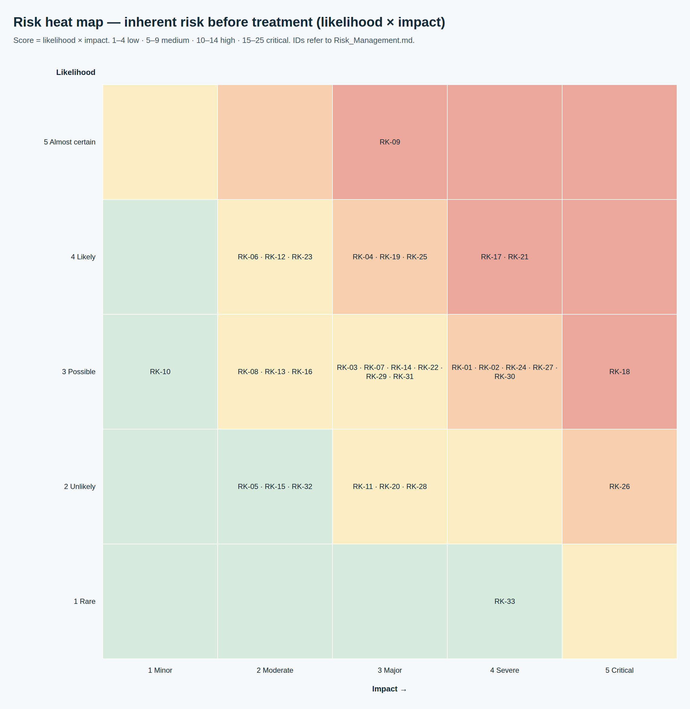

# Risk management — Queensland road crash analysis

*Identifies the risks to the project, from technical to social, assesses them, and sets out how each is managed. For every risk: likelihood and impact, a treatment strategy, mitigation and contingency actions, an early-warning trigger, an owner and the residual rating after treatment. It also defines the risk-management process used during the plan in [`Timeline_and_Milestones.md`](Timeline_and_Milestones.md). Operational monitoring thresholds are in [`Implementation_Design.md`](Implementation_Design.md) §19.*

---

## Contents

1. [Approach](#1-approach)
2. [Risk heat map](#2-risk-heat-map)
3. [Top risks](#3-top-risks)
4. [Risk register](#4-risk-register)
5. [Cross-cutting management strategies](#5-cross-cutting-management-strategies)
6. [Risk-management process](#6-risk-management-process)
7. [Links to the rest of the project](#7-links-to-the-rest-of-the-project)

---

## 1. Approach

**Scales.**

| Score | Likelihood | Impact |
|---|---|---|
| 1 | Rare (<5%) | Minor: hours of rework, no effect on findings |
| 2 | Unlikely (5–25%) | Moderate: days of rework or a caveat on one result |
| 3 | Possible (25–50%) | Major: a milestone slips or a key result needs revising |
| 4 | Likely (50–80%) | Severe: several results invalid, or users misled |
| 5 | Almost certain (>80%) | Critical: harm to people or reputation, legal breach, or project failure |

**Rating** = likelihood × impact: **1–4 low · 5–9 medium · 10–14 high · 15–25 critical**.

**Treatment strategies** (standard risk-management options):

| Strategy | Meaning |
|---|---|
| **Avoid** | Change the plan so the risk can't occur |
| **Reduce** | Lower the likelihood or the impact |
| **Transfer / share** | Move the consequence to a party better placed to manage it |
| **Accept** | Monitor it, with a contingency ready |

**Categories.**
- **T:** technical
- **D:** data and data collection
- **C:** computational
- **E:** deployment environment
- **A:** analytical and methodological
- **P:** personnel
- **S:** stakeholder and organisational
- **L:** legal, ethical and privacy
- **So:** social
- **Sc:** schedule
- **Se:** security

---

## 2. Risk heat map

*Figure 1. Inherent risk (before treatment) by likelihood and impact. Editable draw.io source: [`Write_Ups/figures/risk_heat_map.drawio`](figures/risk_heat_map.drawio). Residual ratings after treatment are in §4.*

**Inherent profile (33 risks).**
- **Critical (15–25):** 4 — RK-09, RK-17, RK-18, RK-21.
- **High (10–14):** 9 — RK-01, RK-02, RK-04, RK-19, RK-24, RK-25, RK-26, RK-27, RK-30.
- **Medium (5–9):** 15.
- **Low (1–4):** 5.

**After treatment:** none critical or high, 10 medium, 23 low (§4).

---

## 3. Top risks

| Rank | Risk | Inherent | Residual | Why it matters most |
|---|---|---|---|---|
| 1 | **RK-18** Model results misused for operational decisions | 15 critical | 5 medium | Wrong targeting of enforcement or resources, and loss of trust |
| 2 | **RK-17** Results read as risk although no exposure data is used | 16 critical | 8 medium | Busy places and groups wrongly labelled dangerous |
| 3 | **RK-21** Key-person dependency | 16 critical | 8 medium | One person holds the knowledge of the pipeline and methods |
| 4 | **RK-09** Tableau builder out of step with V6 exports | 15 critical | 3 low | The primary user product can't be refreshed |
| 5 | **RK-27** Stigmatising areas or communities | 12 high | 6 medium | Electorate and council comparisons are politically sensitive |
| 6 | **RK-01 / RK-02** Source format or severity-grading changes | 12 high | 6 medium | Silent invalidation of trends and models |
| 7 | **RK-30** Public or media misinterpretation | 12 high | 6 medium | Reputational and community harm |
| 8 | **RK-24** Objectives and acceptance criteria never confirmed | 12 high | 4 low | Models can't be judged fit for use |

---

## 4. Risk register

Columns:
- **L, I:** inherent likelihood and impact.
- **Res.:** residual score after treatment.
- **Trigger:** the early-warning sign that the risk is materialising.

### 4.1 Technical (T)

| ID | Risk (cause → effect) | L | I | Score | Strategy | Mitigation | Contingency | Trigger | Owner | Res. |
|---|---|---|---|---|---|---|---|---|---|---|
| RK-07 | Package or Python updates change behaviour → results or runs break | 3 | 3 | 9 | Reduce | Versions recorded in the manifest; lockfile and Docker image (T3, T11); pin before each release | Rebuild the environment from the manifest versions; roll back to the previous release | Run failure or changed numbers on an unchanged-data rerun | Data engineer | 3 |
| RK-08 | Notebook relies on kernel state and run order → out-of-order execution errors | 3 | 2 | 6 | Reduce | Release runs are always top to bottom, headless; heavy logic moved to modules; pytest on modules (T3) | Restart the kernel and run all | NameError or stale variable during interactive work | Data scientist | 2 |
| RK-09 | Tableau builder out of step with the notebook's exports → dashboards can't be built *(V6 builder delivered 27 Nov 2026; the risk recurs whenever export layouts change)* | 5 | 3 | 15 | Reduce | Builder updated for V6 (T2, M2 done); its field-reference checks catch mismatches; rebuild the workbook in every release run | Publish the V6 CSVs and Esri page while the workbook is fixed | Builder error on a V6 run | Data engineer | 3 |
| RK-10 | Scratch tooling and caches live in `.cache/` → lost when the cache is cleared | 3 | 1 | 3 | Avoid | Move the builder and runner to `tools/` (T3); caches rebuild automatically | Recreate from Git history | `.cache/` deleted | Data engineer | 1 |

### 4.2 Data and data collection (D)

| ID | Risk | L | I | Score | Strategy | Mitigation | Contingency | Trigger | Owner | Res. |
|---|---|---|---|---|---|---|---|---|---|---|
| RK-01 | Publisher changes format or coding (columns, categories, IDs) → pipeline fails or misclassifies | 3 | 4 | 12 | Reduce | Fail-fast assertions on files, keys and tallies; profile comparison against the previous release (`Data_and_Resources.md` appendix) | Map new codes in a documented crosswalk; hold the release until resolved | Assertion failure; new category values | Data engineer | 6 |
| RK-02 | Further severity-grading drift or a new recording break → trends and models invalid | 3 | 4 | 12 | Reduce | Severity-mix check and stable-window rule re-derived each run; R5 tolerance test; fatal share used for trends | Move the window; refit everything that uses it; ask the custodian | Latest year outside ±3 points | Data scientist | 6 |
| RK-03 | Rainfall data access delayed (SILO registration or terms, BoM download effort) → M5 slips | 3 | 3 | 9 | Reduce | Decide the source in W1; start registration early; cache downloads | Fall back to nearest BoM stations (station list held) or a monthly join only | No access by the end of W4 | Data engineer | 4 |
| RK-04 | Exposure data incomplete (AADT only on state-controlled roads; ABS boundary changes) → partial rates | 4 | 3 | 12 | Accept and reduce | Scope the safety performance function to state-controlled links; harmonise SA2 editions with ABS correspondences | Keep the excess-proportion screen for local roads; report coverage | AADT coverage <50% of screened links | Data scientist | 6 |
| RK-05 | Location quality (471 unresolved; stacked junction geocodes) → sites missed or merged | 2 | 2 | 4 | Accept | Methods and evidence recorded; stacked points reported per site; unresolved records listed | Manual review of high-impact unresolved crashes | Unresolved count rises >50% | Analyst | 2 |
| RK-06 | Full crash dates refused by the custodian → no daily weather join | 4 | 2 | 8 | Accept | Candidate-day and monthly designs already planned | Proceed without dates | Request declined | Road-safety lead | 8 (accepted) |

### 4.3 Computational (C)

| ID | Risk | L | I | Score | Strategy | Mitigation | Contingency | Trigger | Owner | Res. |
|---|---|---|---|---|---|---|---|---|---|---|
| RK-11 | Smaller machines lack memory for the crash tables, road network and G-NAF → runs fail | 2 | 3 | 6 | Reduce | Streaming reads; caches; profile peak memory in T3 and document the minimum specification | Run on the workstation or a cloud VM | Out-of-memory error | Data engineer | 2 |
| RK-12 | Disk or temp-space quotas (seen on the development machine) → tools fail to write output | 4 | 2 | 8 | Reduce | Write temporary files to the project's `.cache/`; clear old caches; monitor free space | Redirect `TMPDIR`; free space | Quota errors | Data engineer | 3 |
| RK-13 | Rainfall API rate limits or long download time for thousands of locations | 3 | 2 | 6 | Reduce | Deduplicate to grid cells; resumable, cached, rate-limited downloads | Monthly gridded files instead of per-point queries | Throttling responses | Data engineer | 2 |

### 4.4 Deployment environment (E)

| ID | Risk | L | I | Score | Strategy | Mitigation | Contingency | Trigger | Owner | Res. |
|---|---|---|---|---|---|---|---|---|---|---|
| RK-14 | Platform limits or visibility: Tableau Public makes workbooks public; extract-size limits | 3 | 3 | 9 | Reduce | Publish only aggregate or public-data views; check size before upload; consider Tableau Server for internal views | Split extracts; publish crash-level data only internally | Upload rejected; sensitive view proposed for Public | Data engineer | 3 |
| RK-15 | The Esri map page needs internet access (tiles, scripts) → unusable offline | 2 | 2 | 4 | Accept | Documented requirement; static map images in the notebook | Provide PNG snapshots | User reports a blank map | Analyst | 2 |
| RK-16 | Headless or scheduled runs fail (broken `jupyter` launcher, missing `nbconvert`) | 3 | 2 | 6 | Reduce | Runner kept in `tools/`; venv recreated or `python -m jupyter`; Docker image (T11) | Run interactively | Scheduled run reports failure | Data engineer | 2 |

### 4.5 Analytical and methodological (A)

| ID | Risk | L | I | Score | Strategy | Mitigation | Contingency | Trigger | Owner | Res. |
|---|---|---|---|---|---|---|---|---|---|---|
| RK-17 | No exposure data → shares and counts read as risk | 4 | 4 | 16 | Reduce | Exposure caveat in every analysis and product; per-capita and AADT work (T8–T10); standardisation and funnels | Correct communications; add caveat banners to dashboards | Users quote shares as "most dangerous" | Data scientist | 8 |
| RK-18 | Model outputs used to drive operations despite weak precision (about 9 false alerts per hit) | 3 | 5 | 15 | Avoid | Documented limits (R1, R3, R4); quality gates; no deployment without M3 criteria and an M8 decision; shadow mode only | Withdraw outputs; issue a correction | Request to score live crashes or allocate resources from model output | Road-safety lead | 5 |
| RK-19 | Site rankings biased by road-user mix (motorcycle routes) and the reference offset → wrong treatments | 4 | 3 | 12 | Reduce | Motorcycle share and stacked points shown per site; T7 refinements; field review before treatment | Re-rank with the adjusted variant | Shortlist dominated by one road-user group | Data scientist | 6 |
| RK-20 | Analyst choices (windows, thresholds, snap distances) drive the results | 2 | 3 | 6 | Reduce | Sensitivity experiments R5–R7 and E-series; changes documented | Report the range of results | Results change materially under small variations | Data scientist | 2 |

### 4.6 Personnel (P)

| ID | Risk | L | I | Score | Strategy | Mitigation | Contingency | Trigger | Owner | Res. |
|---|---|---|---|---|---|---|---|---|---|---|
| RK-21 | Key-person dependency: one person knows the pipeline → stalls if unavailable | 4 | 4 | 16 | Reduce | Full documentation set; code in modules with docstrings; pair working on T3 and T12; runbook for the release | A second person runs the release from the runbook | Only one person able to run a release | Project lead | 8 |
| RK-22 | Skills gaps (geospatial, Tableau XML builder, Bayesian screening) | 3 | 3 | 9 | Reduce | Design documents explain methods; training time inside tasks; external review of the screening method | Simplify (excess-proportion only); seek specialist help | Tasks repeatedly over estimate | Project lead | 4 |
| RK-23 | Availability over the holiday period and leave → December and January slips | 4 | 2 | 8 | Reduce | Break built into the plan; no milestones in the break; buffer week T14 | Re-sequence independent tasks | Planned leave overlaps critical-path tasks | Project lead | 3 |

### 4.7 Stakeholder and organisational (S)

| ID | Risk | L | I | Score | Strategy | Mitigation | Contingency | Trigger | Owner | Res. |
|---|---|---|---|---|---|---|---|---|---|---|
| RK-24 | Objectives and acceptance criteria not confirmed → no basis to judge models or priorities | 3 | 4 | 12 | Reduce | T1 at the start; M3 sign-off before T13 | Proceed with documented provisional objectives; defer M8 | M3 not met by W2 | Road-safety lead | 4 |
| RK-25 | Scope creep from new requests (more data, more maps) → milestones slip | 4 | 3 | 12 | Reduce | Change control: new requests go to the backlog and are scheduled only if they replace a task or use the buffer | Defer to V8 | Unplanned work exceeds 2 days in a fortnight | Project lead | 4 |

### 4.8 Legal, ethical and privacy (L)

| ID | Risk | L | I | Score | Strategy | Mitigation | Contingency | Trigger | Owner | Res. |
|---|---|---|---|---|---|---|---|---|---|---|
| RK-26 | Re-identification: linking crash sites with news reports or outside records reveals individuals | 2 | 5 | 10 | Avoid | No date reconstruction or outside linkage (E22); public, de-identified data only; aggregate public views; minimum counts on small groups | Remove the view; notify the custodian | Request to link crashes to people or events | Road-safety lead | 3 |
| RK-28 | Licence non-compliance (G-NAF EULA, SILO terms, attribution) | 2 | 3 | 6 | Reduce | Attribution in README and `sources.json`; terms reviewed at acquisition; derived G-NAF data not redistributed beyond the licence | Remove affected outputs; correct attribution | New source without terms reviewed | Data engineer | 2 |

### 4.9 Social (So)

| ID | Risk | L | I | Score | Strategy | Mitigation | Contingency | Trigger | Owner | Res. |
|---|---|---|---|---|---|---|---|---|---|---|
| RK-27 | Area comparisons (councils, electorates) stigmatise communities or are used politically | 3 | 4 | 12 | Reduce | Funnel plots with chance limits; framed as "areas to investigate"; road-mix adjustment; grading caveat; review of electorate outputs before publication | Restrict electorate views to internal use | Media or political use of an area ranking | Road-safety lead | 6 |
| RK-29 | Equity: remote and Indigenous communities under-reported or under-served; urban volume dominates attention | 3 | 3 | 9 | Reduce | Severity measures and standardisation highlight remote severity; caveat on under-reporting; consult regional stakeholders | Commission a targeted remote-roads analysis | Treatment lists exclude remote areas despite high severity | Road-safety lead | 4 |
| RK-30 | Public or media misinterpretation of published dashboards (for example "most dangerous road") | 3 | 4 | 12 | Reduce | Plain-language notes and caveats on every view; release notes; no league tables without uncertainty | Issue clarifications; amend the views | Misleading external citation | Road-safety lead | 6 |

### 4.10 Schedule (Sc)

| ID | Risk | L | I | Score | Strategy | Mitigation | Contingency | Trigger | Owner | Res. |
|---|---|---|---|---|---|---|---|---|---|---|
| RK-31 | Data-access delays (T5, T9) and the holiday break push the critical path | 3 | 3 | 9 | Reduce | Early source decisions; T14 buffer; weekly RAG; independent tasks re-sequenced | Cut T11 or T15; move M8 by ≤1 week | Amber RAG on M5 or M6 | Project lead | 4 |

### 4.11 Security (Se)

| ID | Risk | L | I | Score | Strategy | Mitigation | Contingency | Trigger | Owner | Res. |
|---|---|---|---|---|---|---|---|---|---|---|
| RK-32 | Credential leakage (SILO email or API key committed to Git) | 2 | 2 | 4 | Avoid | Credentials supplied at run time from environment variables; `.gitignore`; secret scan before push | Rotate the credential; purge history | Secret detected in a diff | Data engineer | 1 |
| RK-33 | Loading a tampered cache pickle executes code | 1 | 4 | 4 | Avoid | Caches only created and read locally; never load pickles from outside; content-keyed names | Delete `.cache/` and rebuild | Cache file of unknown origin | Data engineer | 1 |

**Residual profile after treatment:**
- **None critical or high.**
- **Medium:** 10 — RK-01, RK-02, RK-04, RK-06 (accepted), RK-17, RK-18, RK-19, RK-21, RK-27, RK-30.
- **Low:** 23.

RK-17 (exposure) and RK-21 (key person), both at 8, stay the main residual risks until exposure data (T8–T10) and a second trained operator (T12 pairing) are in place.

---

## 5. Cross-cutting management strategies

| Strategy | Risks addressed | How it works in this project |
|---|---|---|
| **Quality gates and fail-fast checks** | RK-01, RK-02, RK-07, RK-09 | In-run assertions, recording and severity-mix checks, release review gates (`Implementation_Design.md` §9, §18) |
| **Reproducibility by design** | RK-07, RK-08, RK-21 | Seed, pinned versions, manifest, content-keyed caches, headless runs, lockfile and Docker |
| **Sensitivity and reliability testing** | RK-18, RK-19, RK-20 | R1–R7 and the E-series (`Model_Engineering.md` §11) re-run at each release |
| **Honest communication of uncertainty** | RK-17, RK-27, RK-30 | Intervals, funnel limits, caveats and "investigate, don't rank" framing in every product |
| **Staged deployment** | RK-18, RK-14 | Batch outputs only; any model in shadow mode first; internal before public |
| **Knowledge sharing** | RK-21, RK-22 | Documentation set, runbook, pairing on releases, design reviews |
| **Early decisions and buffers** | RK-03, RK-23, RK-25, RK-31 | Source choices in W1; buffer week; change control; scope-cut order (T11, then T15) |
| **Privacy and ethics by default** | RK-26, RK-28, RK-29 | No re-identification, attribution and licence checks, equity review of outputs |
| **Secure handling** | RK-32, RK-33 | Runtime credentials, secret scanning, local-only caches |

---

## 6. Risk-management process

1. **Identify:** at project start (done), at every milestone, and whenever a new data source or product is added.
2. **Assess:** likelihood and impact on the scales in §1; record the inherent score.
3. **Treat:** choose a strategy; assign mitigation, contingency, trigger and owner; estimate the residual score.
4. **Monitor:**
   - The **fortnightly risk review** covers the top 10 risks, triggers hit, new risks and closed risks.
   - **Release gates** check data, method and communication risks before publication.
   - The monitoring thresholds in `Implementation_Design.md` §19 act as automatic triggers.
5. **Escalate:** any risk whose residual reaches **high (≥10)**, or whose trigger fires on the critical path, goes to the road-safety lead within two working days.
6. **Record:** this register is versioned with the code. Each review updates scores and status and records closed risks with the reason.

**Roles.**
- **Project lead:** owns the process.
- **Risk owners:** run the mitigations.
- **Road-safety lead:** decides on escalations and accepts residual risk.
- **Whole team:** raises new risks.

---

## 7. Links to the rest of the project

| Area | Where it connects |
|---|---|
| Timeline | Buffer T14, the critical path and the scope-cut order (`Timeline_and_Milestones.md` §6–7) |
| Implementation | Monitoring thresholds, release gates, deployment plan, technical-debt table (`Implementation_Design.md` §15, §18–19) |
| Data | Data still to collect, data quality, licensing (`Data_and_Resources.md` §7, §8, §10) |
| Methods and models | Limits and reliability evidence (`Model_Engineering.md` §3.8, §5.4, §11; `Analytics_Methods.md` §4) |
| Goals | Objectives awaiting confirmation (`Analytical_Goals_and_Tasks.md`) |
| Architecture | Governance band and quality attributes (`Analytical_System_Architecture.md` §3, §8) |

---

<!-- project-docs-nav -->
**Project documentation:** [Index](Documentation_Index.md) · [Goals and tasks](Analytical_Goals_and_Tasks.md) · [Data and resources](Data_and_Resources.md) · [Data engineering](Data_Engineering.md) · [Analytics methods](Analytics_Methods.md) · [Model engineering](Model_Engineering.md) · [Implementation design](Implementation_Design.md) · [System architecture](Analytical_System_Architecture.md) · [Timeline and milestones](Timeline_and_Milestones.md) · **Risk management**
