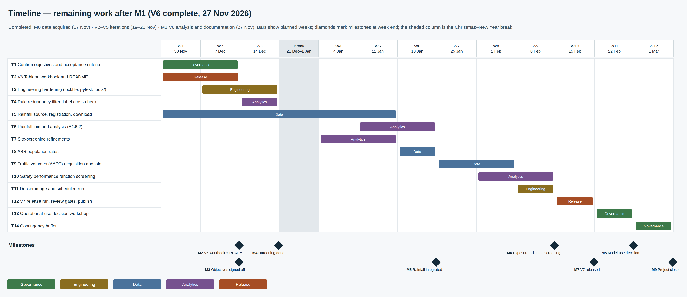

# Timeline and milestones — Queensland road crash analysis

*Sets out the project's time frame, the time allocated to each task, and the milestones used to monitor progress. The first part records what has been completed, with dates taken from file and commit timestamps. The second is the plan for the remaining work from 30 November 2026 to 5 March 2027. Tasks trace back to the analytical tasks in [`Analytical_Goals_and_Tasks.md`](Analytical_Goals_and_Tasks.md) and the activities in [`Implementation_Design.md`](Implementation_Design.md) §20. Schedule risks are managed in [`Risk_Management.md`](Risk_Management.md).*

---

## Contents

1. [Time frame at a glance](#1-time-frame-at-a-glance)
2. [Completed work (actual)](#2-completed-work-actual)
3. [Plan for the remaining work](#3-plan-for-the-remaining-work)
4. [Time allocation](#4-time-allocation)
5. [Milestones and acceptance criteria](#5-milestones-and-acceptance-criteria)
6. [Dependencies and critical path](#6-dependencies-and-critical-path)
7. [Monitoring and managing progress](#7-monitoring-and-managing-progress)
8. [Assumptions and calendar](#8-assumptions-and-calendar)

---

## 1. Time frame at a glance



*Figure 1. Gantt chart of the remaining work. Bars are planned weeks, coloured by workstream; diamonds are milestones at week end; the shaded column is the Christmas–New Year break. Editable draw.io source: [`Write_Ups/figures/timeline_gantt.drawio`](figures/timeline_gantt.drawio).*

| Stage | Dates | Duration | Status |
|---|---|---|---|
| Data acquisition and V2–V5 development | 17–20 Nov 2026 | 4 days | Done |
| Review of V5 and V6 build, experiments, documentation | 27 Nov 2026 | 1 day (intensive) | Done (M1) |
| Remaining work, T1–T14 | 30 Nov 2026 – 5 Mar 2027 | 12 working weeks, plus a 2-week break | Planned |
| Conditional: rolling-origin evaluation | When the 2025 crash data is complete | 3 person-days | Waiting on publisher |

**Total planned effort for the remaining work:** 58 person-days over 12 working weeks.

---

## 2. Completed work (actual)

| Date | Work | Evidence | CRISP-ML(Q) phase |
|---|---|---|---|
| 17 Nov 2026 | Six crash CSVs downloaded | File timestamps of the source CSVs | 1 |
| 19 Nov 2026 | Spatial layers retained; V2 notebook (location recovery first version); spatial matching utility | `Public spatial data/`, `Archive/Traffic_Incidents_V2.ipynb`, `traffic_spatial_lookup.py` | 1–2 |
| 20 Nov 2026 | V3, V4 and V5 notebooks; Tableau workbooks; Esri map page; V5 release manifest | `Archive/`, `Queensland Traffic V5.twbx`, manifest | 2–5 |
| **M0** 20 Nov 2026 | V5 analytical release | `Traffic_Incidents_V5.ipynb` | — |
| 27 Nov 2026 | Git repository created; V5 review (`Review_Improvements_05.md`) | Commits `eff42ac`, `37e827d`, `d601b8e` | 6 → 1 |
| 27 Nov 2026 | V6 build: severity-drift fix, crash-level fields, road-site screening, new models, location-recovery module | `Traffic_Incidents_V6.ipynb`, `traffic_location_recovery.py`, `traffic_road_sites.py` | 2–4 |
| 27 Nov 2026 | Reliability experiments R1–R7; documentation set; draw.io diagrams | Phase 4 cells; the `.md` files; `Write_Ups/figures/` | 4–6 |
| **M1** 27 Nov 2026 | **V6 analysis and documentation complete** | This document set | — |

---

## 3. Plan for the remaining work

Weeks start on Mondays. Task IDs T1–T14 match Figure 1.

| Task | Description | Weeks | Dates | Effort (person-days) | Role | Depends on | Delivers | Links |
|---|---|---|---|---|---|---|---|---|
| **T1** | Confirm business objectives and acceptance criteria with stakeholders | W1–W2 | 30 Nov – 11 Dec | 3 | Road-safety lead, analyst | — | M3 | A12; BO1–BO6 |
| **T2** | Update `build_tableau_workbook.py` for V6 tables; publish the V6 workbook; update README — **done early (27 Nov) except publishing** | W1–W2 | 30 Nov – 11 Dec | 4 | Data engineer | M1 | M2 | A7, A8 |
| **T3** | Engineering hardening: lockfile, pytest suite on a fixture extract, move tools to `tools/`, fix the venv launcher | W2–W3 | 7–18 Dec | 5 | Data engineer | M1 | M4 | A9 |
| **T4** | Association-rule redundancy filter; recorded vs polygon label cross-check | W3 | 14–18 Dec | 2 | Data scientist | M1 | Notebook update | AT1.2, AT5.1.2 |
| **T5** | Choose the rainfall source (SILO vs BoM) in W1; register; build and run the cached download | W1–W5 | 30 Nov – 15 Jan | 6 (mostly W4–W5) | Data engineer | T1 decision | Rainfall data | A10; AT6.2.1 |
| **T6** | `traffic_weather.py` join (month and candidate days) and analysis | W5–W6 | 11–22 Jan | 5 | Data scientist | T5 | M5 | AG6.2 |
| **T7** | Site screening: site-frequency strata and a road-user-adjusted variant | W4–W5 | 4–15 Jan | 4 | Data scientist | M1 | Screening v2 | AG1.1; E16, E18 |
| **T8** | ABS population rates by SA2 and LGA | W6 | 18–22 Jan | 3 | Analyst | — | Per-capita tables | A11; AG2.1 |
| **T9** | Traffic volumes (AADT) acquisition and join to road links | W7–W8 | 25 Jan – 5 Feb | 6 | Data engineer | T7 | Exposure on links | A11 |
| **T10** | Safety-performance-function screening with AADT; re-run persistence and robustness tests | W8–W9 | 1–12 Feb | 5 | Data scientist | T9 | M6 | AG1.1 |
| **T11** | Docker image; scheduled headless run (cron) | W9 | 8–12 Feb | 3 | Data engineer | T3 | Release runtime | A9; Implementation §18 |
| **T12** | V7 release: cold run, review gates, documentation updates, publish | W10 | 15–19 Feb | 4 | Whole team | T6, T10, T11 | M7 | Implementation §18 |
| **T13** | Operational-use decision workshop and report | W11 | 22–26 Feb | 3 | Road-safety lead, data scientist | M3, M7 | M8 | A12; BO4 |
| **T14** | Contingency buffer (absorbs slips on T5, T9 and the review gates) | W12 | 1–5 Mar | 5 | — | — | M9 | Risk_Management RK-31 |
| *T15 (conditional)* | Rolling-origin evaluation once 2025 is a complete year | When released | — | 3 | Data scientist | Publisher release | Model evaluation update | Model_Engineering §11.4 |

---

## 4. Time allocation

**By workstream** (planned remaining effort, 58 person-days):

| Workstream | Tasks | Person-days | Share |
|---|---|---|---|
| Analytics | T4, T6, T7, T10 | 16 | 28% |
| Data | T5, T8, T9 | 15 | 26% |
| Governance | T1, T13, T14 | 11 | 19% |
| Engineering | T3, T11 | 8 | 14% |
| Release | T2, T12 | 8 | 14% |

**By role:**

| Role | Person-days | Peak weeks |
|---|---|---|
| Data scientist | 21 (T4, T6, T7, T10, half of T13, part of T12) | W4–W6, W8–W9 |
| Data engineer | 24 (T2, T3, T5, T9, T11, part of T12) | W1–W3, W7–W9 |
| Analyst | 5 (T8, part of T1) | W6 |
| Road-safety lead | 3 (T1, T13) | W1–W2, W11 |
| Unallocated buffer | 5 (T14) | W12 |

Role totals include shared tasks and are approximate.

**By CRISP-ML(Q) phase** (each task counted once, under its primary phase):

| Phase | Tasks | Person-days | Share |
|---|---|---|---|
| 1 Business and data understanding | T1 | 3 | 5% |
| 2 Data preparation and QA | T5, T8, T9 | 15 | 26% |
| 3 Modelling | T4, T7, T10 | 11 | 19% |
| 4 Evaluation | T6 | 5 | 9% |
| 5 Deployment readiness | T2, T3, T11, T12 | 16 | 28% |
| 6 Monitoring and maintenance | T13, T14 | 8 | 14% |
| **Total** | | **58** | 100% |

**Capacity check.** W1–W12 hold 59 working days per person (Australia Day removed). With one data scientist and one data engineer at about 0.5 FTE each over the period, plus short stakeholder sessions, about 58 days is achievable. Peak weeks (W8–W9) stay under about 4 days per person per week.

---

## 5. Milestones and acceptance criteria

| Milestone | Target date | Acceptance criteria (definition of done) | Evidence |
|---|---|---|---|
| **M0** V5 release | 20 Nov 2026 ✅ | V5 notebook, workbook and map page produced | `Archive/`, V5 files |
| **M1** V6 analysis and documentation | 27 Nov 2026 ✅ | Notebook runs end-to-end with no errors; V5 location outputs reproduced byte for byte; R1–R7 run; documents complete | Run log; manifest; documents |
| **M2** V6 workbook and README published | Fri 11 Dec 2026 — **built 27 Nov 2026 ✅** (publishing to Tableau Public/Server remains) | Workbook builds from `Tableau data V6/` with all sheet references valid; README describes V6 and links the document index | `.twbx`, README |
| **M3** Objectives and acceptance criteria signed off | Fri 11 Dec 2026 | BO1–BO6 confirmed or revised; fatal-alert precision and recall targets agreed; owner named for each objective | Signed-off note in `Analytical_Goals_and_Tasks.md` |
| **M4** Engineering hardening done | Fri 18 Dec 2026 | Lockfile committed; pytest suite passes on a fixture extract; tools moved to `tools/`; headless run works with standard tooling | CI or local test log |
| **M5** Rainfall integrated | Fri 22 Jan 2027 | Rainfall joined for ≥95% of observed crashes; agreement with recorded "Raining" reported; AG6.2 analysis in the notebook | Notebook section; `result_rainfall_*` |
| **M6** Exposure-adjusted screening | Fri 12 Feb 2027 | AADT joined to state-controlled links; screening with a safety performance function; persistence and robustness re-tested (top-100 overlap ≥90 under variants) | Updated screening tables |
| **M7** V7 released | Fri 19 Feb 2027 | All review gates passed (`Implementation_Design.md` §18); manifest and tag created; documents updated | Tag `v7.0`; release notes |
| **M8** Operational-use decision | Fri 26 Feb 2027 | Decision recorded (use, pilot in shadow mode, or no use) against the M3 acceptance criteria | Decision report |
| **M9** Project close | Fri 5 Mar 2027 | Buffer used or released; risks reviewed and handed to the maintenance owner | Close-out note; updated risk register |

---

## 6. Dependencies and critical path

```text
T1 ──► M3 ─────────────────────────────────────────────────────────► T13 ──► M8
T5 ──► T6 ──► M5 ─────────────────────────────┐
T7 ──► T9 ──► T10 ──► M6 ─────────────────────┼──► T12 ──► M7 ──► T13
T3 ──► M4 ──► T11 ────────────────────────────┘
```

- **Critical path:** T7 → T9 → T10 → T12 → T13 (12 weeks including the break). A delay to traffic-volume acquisition (T9) moves M6, M7 and M8 day for day. The buffer (T14) absorbs up to one week.
- **Near-critical:** T5 → T6 (rainfall). It depends on data access (registration, terms). If the source isn't confirmed by the end of W1, switch to the BoM station fallback (Risk RK-03).
- **Independent:** T2, T4 and T8 can move within their windows without affecting milestones.

---

## 7. Monitoring and managing progress

| Mechanism | Frequency | Content | Owner |
|---|---|---|---|
| Task board (GitHub Issues/Projects, one issue per task T1–T14) | Continuous | Status: to do, in progress, review, done; linked commits | Each task owner |
| Status check-in | Weekly (Friday) | Tasks done, next week, blockers; RAG status per milestone; effort used against plan | Data scientist |
| Milestone review | At each milestone | Acceptance criteria checked against evidence; go or no-go for dependent tasks | Road-safety lead |
| Risk review | Fortnightly, and at each milestone | Top risks, triggers hit, new risks (`Risk_Management.md` §6) | Project lead |
| Effort burn-up | Weekly | Planned (58 days) vs actual vs earned | Data scientist |
| Release gates | At M7 | Implementation §18 checklist | Whole team |

**RAG rules:**
- **Green:** on track.
- **Amber:** at risk of ≤1 week slip; use the buffer.
- **Red:** more than 1 week slip, or acceptance criteria at risk. Escalate to the road-safety lead and re-plan; the options are to cut scope (drop T11 or T15 first) or move M8.

---

## 8. Assumptions and calendar

- **Calendar:** the plan starts Monday 30 Nov 2026. There is no work from 21 Dec 2026 to 1 Jan 2027, and Australia Day (Tue 26 Jan 2027) is a holiday.
- **Staffing:** a data scientist and a data engineer at about 0.5 FTE each, with the analyst and road-safety lead available for short sessions. One person can cover several roles.
- **Data access:** SILO registration or BoM downloads, ABS population tables and TMR traffic volumes are obtainable within their task windows (otherwise see Risk_Management RK-03 and RK-04).
- **Environment:** the current workstation is enough. No cloud resources are needed.
- **Conditional work:** T15 waits on the publisher completing 2025. It is excluded from the 58 days.

---

<!-- project-docs-nav -->
**Project documentation:** [Index](Documentation_Index.md) · [Goals and tasks](Analytical_Goals_and_Tasks.md) · [Data and resources](Data_and_Resources.md) · [Data engineering](Data_Engineering.md) · [Analytics methods](Analytics_Methods.md) · [Model engineering](Model_Engineering.md) · [Implementation design](Implementation_Design.md) · [System architecture](Analytical_System_Architecture.md) · **Timeline and milestones** · [Risk management](Risk_Management.md)
